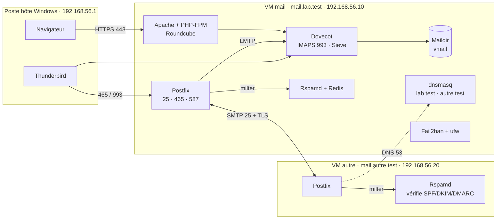

# Laboratoire de serveur de messagerie auto-hébergé

Conception, déploiement et documentation, de bout en bout, d'une messagerie complète sous Linux : **Postfix, Dovecot, Rspamd, Roundcube**, avec TLS, SPF, DKIM, DMARC, Fail2ban. Prochaine étape : automatisation **Ansible**.

> **Projet de laboratoire.** Deux machines virtuelles VirtualBox sur un poste personnel, domaines fictifs `lab.test` et `autre.test`, aucune exposition à Internet. Ce n'est pas un déploiement de production : voir [Limites](#limites--ce-qui-diffère-de-la-production).

---

## Ce que démontre ce projet

| Compétence | Où la voir |
| --- | --- |
| Administration Linux (Ubuntu Server 24.04 LTS) : réseau, systemd, journaux, permissions | [Étape 2](docs/etape-02-vm.md) |
| DNS : enregistrements A, MX, PTR, TXT ; résolveur local | [Étape 3](docs/etape-03-dns.md), [Étape 10](docs/etape-10-spf-dkim-dmarc.md) |
| Messagerie : SMTP, IMAP, LMTP, Maildir, utilisateurs virtuels | [Étape 4](docs/etape-04-postfix.md), [Étape 5](docs/etape-05-dovecot.md), [Étape 6](docs/etape-06-virtuels.md) |
| PKI : autorité de certification OpenSSL, TLS sur tous les services | [Étape 7](docs/etape-07-tls-sasl.md) |
| Authenticité des messages : SPF, DKIM, DMARC vérifiés entre deux domaines | [Étape 10](docs/etape-10-spf-dkim-dmarc.md) |
| Sécurité : pare-feu, anti-relais, anti-force-brute, anti-spam | [Étape 7](docs/etape-07-tls-sasl.md), [Étape 9](docs/etape-09-rspamd.md), [Étape 11](docs/etape-11-fail2ban.md), [SECURITY.md](SECURITY.md) |
| Web : Apache, PHP-FPM, webmail en HTTPS | [Étape 12](docs/etape-12-webmail.md) |
| Diagnostic : erreurs analysées et corrigées à chaque étape | Section « Problèmes rencontrés » de chaque page |

## Architecture



Détails et glossaire : [docs/00-architecture.md](docs/00-architecture.md).

## Pile technique

| Composant | Rôle |
| --- | --- |
| Ubuntu Server 24.04.5 LTS | Système des VM |
| Postfix | MTA (réception sur 25) et MSA (soumission authentifiée sur 465 et 587) |
| Dovecot | IMAPS, livraison LMTP, authentification SASL pour Postfix, Sieve |
| Rspamd + Redis | Filtrage anti-spam, signature et vérification DKIM, SPF, DMARC |
| Apache + PHP-FPM + Roundcube | Webmail en HTTPS, filtres Sieve via ManageSieve |
| dnsmasq | DNS des deux domaines du labo |
| OpenSSL | Autorité de certification locale |
| Fail2ban + ufw | Pare-feu et blocage des tentatives répétées |

## Résultats

| Critère d'acceptation | Résultat | Preuve |
| --- | --- | --- |
| Échange entre `mbsuser` et `alice` | ✅ | [tests/etape-06.md](tests/etape-06.md) |
| IMAP chiffré, en ligne de commande et dans Thunderbird | ✅ | [tests/etape-07.md](tests/etape-07.md) |
| Envoi authentifié sur 465 et 587 ; relais non authentifié refusé (`554 5.7.1`) | ✅ | [tests/etape-07.md](tests/etape-07.md), [tests/etape-08.md](tests/etape-08.md) |
| Messages signés DKIM ; `spf=pass dkim=pass dmarc=pass` vu par l'autre domaine | ✅ | [tests/etape-10.md](tests/etape-10.md) |
| Usurpation de `lab.test` rejetée (`DMARC p=reject`) | ✅ | [tests/etape-10.md](tests/etape-10.md) |
| Webmail en HTTPS sans avertissement, filtres, spam rangé dans *Pourriels* | ✅ | [tests/etape-12.md](tests/etape-12.md) |
| Permissions des Maildir (`700`/`600`, propriétaire `vmail`) | ✅ | [tests/etape-06.md](tests/etape-06.md) |
| Force brute bloquée par Fail2ban | ✅ | [tests/etape-11.md](tests/etape-11.md) |

## Démarche

Chaque composant a été installé **à la main, paramètre par paramètre**, avec un instantané de VM avant chaque étape et des erreurs provoquées volontairement pour apprendre à lire les journaux. L'automatisation (étape 13, en cours) viendra ensuite, pour rejouer ce qui a été compris.

| Étape | Contenu | Page |
| --- | --- | --- |
| 0 | Cahier des charges v1.1 | [cahier-des-charges](docs/cahier-des-charges.md) |
| 1 | Architecture, chemin d'un e-mail | [00-architecture](docs/00-architecture.md) |
| 2 | VM, réseau, SSH par clé, pare-feu | [etape-02](docs/etape-02-vm.md) |
| 3 | DNS local (dnsmasq) | [etape-03](docs/etape-03-dns.md) |
| 4 | Postfix en livraison locale | [etape-04](docs/etape-04-postfix.md) |
| 5 | Dovecot et IMAP | [etape-05](docs/etape-05-dovecot.md) |
| 6 | Utilisateurs virtuels et LMTP | [etape-06](docs/etape-06-virtuels.md) |
| 7 | CA locale, TLS, authentification SMTP | [etape-07](docs/etape-07-tls-sasl.md) |
| 8 | Second domaine et échanges entre serveurs | [etape-08](docs/etape-08-deux-domaines.md) |
| 9 | Rspamd et Redis | [etape-09](docs/etape-09-rspamd.md) |
| 10 | SPF, DKIM, DMARC | [etape-10](docs/etape-10-spf-dkim-dmarc.md) |
| 11 | Fail2ban | [etape-11](docs/etape-11-fail2ban.md) |
| 12 | Webmail Roundcube | [etape-12](docs/etape-12-webmail.md) |
| 13 | Automatisation Ansible | *En cours* |

## Organisation du dépôt

```text
mail-server-lab/
├── README.md           # cette page
├── SECURITY.md         # choix de sécurité, compromis assumés, gestion des secrets
├── docs/               # une page par étape, architecture
├── configs/            # configurations réelles des deux VM (secrets retirés)
├── scripts/            # mailuser.sh, collecte des configurations
└── tests/              # commandes de validation et sorties obtenues
```

## Limites : ce qui diffère de la production

| Élément | En laboratoire | En production | Ce qui n'est pas appris |
| --- | --- | --- | --- |
| Port 25 et Internet | Trafic entre deux VM | Port 25 souvent bloqué par les fournisseurs | Faire lever ce blocage, passer par un relais |
| Reverse DNS (PTR) | Servi par dnsmasq | Configuré chez l'hébergeur de l'IP | Effet réel sur l'acceptation des messages |
| Délivrabilité | Vérifiée entre `lab.test` et `autre.test` | Gmail, Outlook, réputation | Résultats chez les grands fournisseurs |
| Certificats | CA locale OpenSSL | Let's Encrypt, renouvellement automatique | Renouvellement en conditions réelles |
| Attaques | Simulées depuis la seconde VM | Automatisées dès la mise en ligne | Réglage sur du trafic réel |
| Antivirus | Exclu (8 Go de RAM sur l'hôte) | ClamAV ou équivalent | Intégration et coût mémoire |
| Rapports DMARC | Adresse `rua` non exploitée | Rapports agrégés quotidiens | Lecture et exploitation |
| Sauvegarde | Instantanés VirtualBox | Sauvegardes externalisées, restaurations testées | Stratégie de reprise |
| Haute disponibilité | Un serveur par domaine | MX secondaire, redondance | Architecture redondante |

## Environnement

HP EliteBook 840 G8 (Intel Core i5 11e génération, 8 Go de RAM), Windows, VirtualBox 7.x. VM `mail` : 2 vCPU, 3 Go. VM `autre` : 1 vCPU, 1,5 Go.

## Auteur

**Apovo Emmanuel Eliel** — ingénieur administrateur systèmes cloud, Master 1 Systèmes, Réseaux et Cloud.
