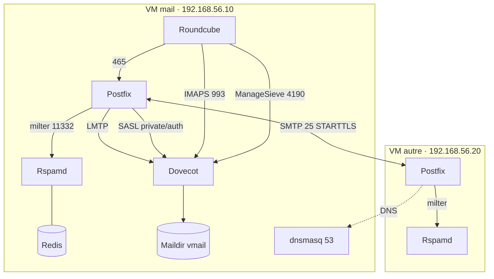

# Architecture et chemin d'un e-mail

## Vue d'ensemble

| Machine | Rôle | Adresse | Ressources |
| --- | --- | --- | --- |
| Poste hôte (Windows) | Client : Thunderbird, navigateur, SSH | `192.168.56.1` | HP EliteBook 840 G8, 8 Go |
| VM `mail` | Serveur de `lab.test` : Postfix, Dovecot, Rspamd, Redis, Apache, PHP-FPM, Roundcube, dnsmasq, Fail2ban | `192.168.56.10` | 2 vCPU, 3 Go, 25 Go |
| VM `autre` | Serveur « distant » de `autre.test` : Postfix, Rspamd, Redis | `192.168.56.20` | 1 vCPU, 1,5 Go, 12 Go |

Chaque VM a deux cartes : **NAT** (`enp0s3`, accès sortant à Internet pour les paquets) et **réseau privé hôte** (`enp0s8`, `192.168.56.0/24`, tout le trafic du labo).

## Chemin d'un e-mail

Exemple : `alice@lab.test` écrit à `test@autre.test` depuis Thunderbird.

| # | Étape | Composant | Rôle |
| --- | --- | --- | --- |
| 1 | Rédaction | Thunderbird | **MUA** (Mail User Agent) |
| 2 | Soumission sur le port 465, TLS + mot de passe | Postfix `submissions` | **MSA** (Mail Submission Agent) ; Dovecot vérifie le mot de passe (SASL) |
| 3 | Analyse et signature DKIM | Rspamd (milter) | Ajoute `DKIM-Signature: d=lab.test; s=2026a` |
| 4 | Recherche du destinataire | Postfix → dnsmasq | `MX autre.test` → `mail.autre.test` → `192.168.56.20` |
| 5 | Transfert sur le port 25, STARTTLS | Postfix → Postfix | **MTA** (Mail Transfer Agent) |
| 6 | Vérification SPF, DKIM, DMARC | Rspamd sur `autre` | `Authentication-Results: spf=pass dkim=pass dmarc=pass` |
| 7 | Dépôt dans la boîte | Postfix `local` sur `autre` (Dovecot LMTP sur `mail`) | **MDA** (Mail Delivery Agent) |
| 8 | Lecture | Client IMAP | Dovecot présente le Maildir |

Les en-têtes `Received:` d'un message, lus **de bas en haut**, racontent ce trajet.

## Glossaire

| Terme | Définition |
| --- | --- |
| Enveloppe | Adresses `MAIL FROM` et `RCPT TO` échangées entre serveurs ; distinctes de l'en-tête `From:` affiché |
| Maildir | Format de stockage : un fichier par message, dossiers `tmp/`, `new/`, `cur/` |
| LMTP | Variante de SMTP pour la livraison locale, de Postfix vers Dovecot |
| SASL | Mécanisme d'authentification ; Postfix délègue la vérification à Dovecot |
| STARTTLS / TLS implicite | Chiffrement négocié après connexion (587, 25) ou dès la connexion (465, 993) |
| Milter | Protocole par lequel Postfix confie un message à un filtre (Rspamd) pendant la session SMTP |
| SPF | Liste des adresses IP autorisées à envoyer pour un domaine |
| DKIM | Signature cryptographique du message par le domaine émetteur |
| DMARC | Politique qui exige un SPF ou un DKIM valide **et aligné** sur le domaine du `From:` |
| Sieve | Langage de filtres appliqués à la livraison |
| Relais ouvert | Serveur qui accepte de transmettre le courrier de n'importe qui vers n'importe où |
