# Étape 2 — Machine virtuelle, réseau et accès

**Objectif** : une VM Ubuntu Server 24.04.5 LTS minimale, joignable en SSH par clé sur `192.168.56.10`, à l'heure, journalisée et protégée par ufw.
**Instantané** : `02-base`

## Ce qui a été fait

| Élément | Choix | Raison |
| --- | --- | --- |
| Hyperviseur | VirtualBox 7.x, VT-x activé, Hyper-V désactivé | Éviter le mode dégradé de VirtualBox sous Windows |
| ISO | `ubuntu-24.04.5-live-server-amd64.iso`, empreinte SHA256 vérifiée | Intégrité du support d'installation |
| Installation | Ubuntu Server *minimized*, LVM étendu à tout le disque | Moins de paquets, moins de surface d'attaque |
| Réseau | Carte 1 NAT (DHCP), carte 2 réseau privé hôte `192.168.56.10/24` fixe | Accès Internet sortant + labo joignable depuis l'hôte |
| Nom | `mail`, FQDN `mail.lab.test` dans `/etc/hosts` | Postfix s'annonce sous ce nom |
| Accès | Compte d'administration `emma`, SSH par clé ed25519, mot de passe et `root` refusés | Exigence de durcissement |
| Horloge | `Africa/Porto-Novo`, `systemd-timesyncd` | DKIM et certificats dépendent de l'heure |
| Journaux | rsyslog → `/var/log/mail.log` | Fichier lu par Fail2ban |
| Pare-feu | ufw : tout refusé en entrée, SSH autorisé sur `enp0s8` depuis `192.168.56.0/24` | Exigence ES4 |

Configuration de référence : [`configs/mail/netplan/`](../configs/mail/), [`configs/mail/ssh/10-lab.conf`](../configs/mail/).

```yaml
# /etc/netplan/50-cloud-init.yaml
network:
  version: 2
  ethernets:
    enp0s3:            # NAT : accès sortant à Internet
      dhcp4: true
    enp0s8:            # Réseau privé hôte : labo
      dhcp4: false
      dhcp6: false
      addresses:
        - 192.168.56.10/24
```

## Vérifications

Voir [`tests/etape-02.md`](../tests/etape-02.md).

## Problèmes rencontrés et solutions

| Problème | Cause | Solution | À retenir |
| --- | --- | --- | --- |
| Route par défaut ajoutée sur `enp0s8` avec `via: 192.168.56.1/24` | Une passerelle ne prend pas de masque ; la carte NAT fournit déjà la route par défaut | Bloc `routes` supprimé | Une seule route par défaut par machine |
| `echo $SSH_CONNECTION` affichait `10.0.2.2` | Connexion par redirection de port NAT (`ssh -p 22 emma@localhost`), qui contourne le réseau du labo et serait coupée par ufw | Connexion par `192.168.56.10`, redirection de port supprimée | Vérifier par où arrive une connexion avant de fermer le pare-feu |
| Le compte d'administration s'appelait comme une boîte de test (`emma`) | Collision de rôles avec l'exigence ES7 (boîtes sans shell) | `emma` garde le rôle d'administration ; la boîte de test devient `alice` | Séparer comptes d'administration et comptes de service |
| `grep manage_etc_hosts /etc/cloud/` remontait des dizaines de lignes | La recherche incluait les modèles de `/etc/cloud/templates/` | Recherche limitée à `cloud.cfg` et `cloud.cfg.d/` ; `manage_etc_hosts: false` explicite | Lire *où* un résultat a été trouvé avant de conclure |
| `/var/log/mail.log` absent | Normal : aucun service de messagerie n'avait encore écrit | Test avec `logger -p mail.info` | Un journal n'existe qu'après le premier message |

## Ce que j'ai appris

- Le rôle respectif des cartes NAT et réseau privé hôte dans VirtualBox.
- `netplan try` comme filet de sécurité avant d'appliquer une configuration réseau.
- L'ordre de priorité des fichiers `sshd_config.d/` (la première valeur lue l'emporte).

## Captures

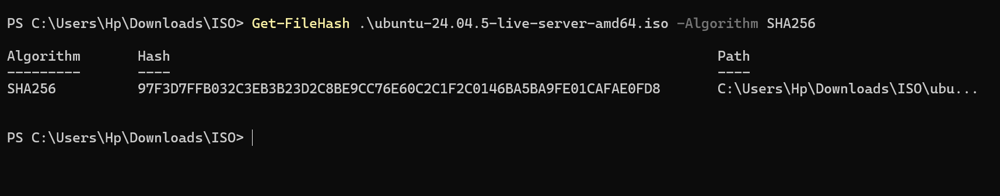
*Empreinte SHA256 de l'ISO vérifiée*

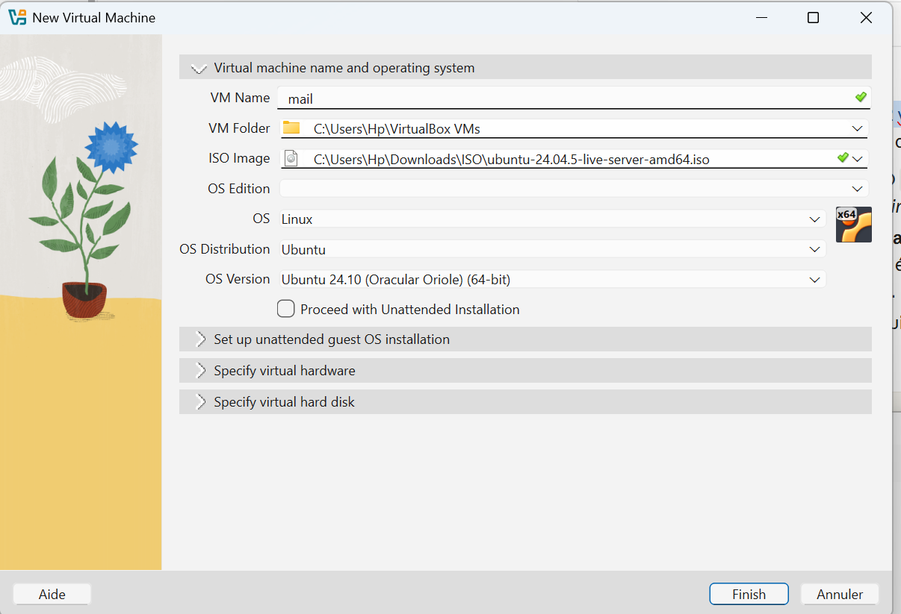
*Création de la VM mail*

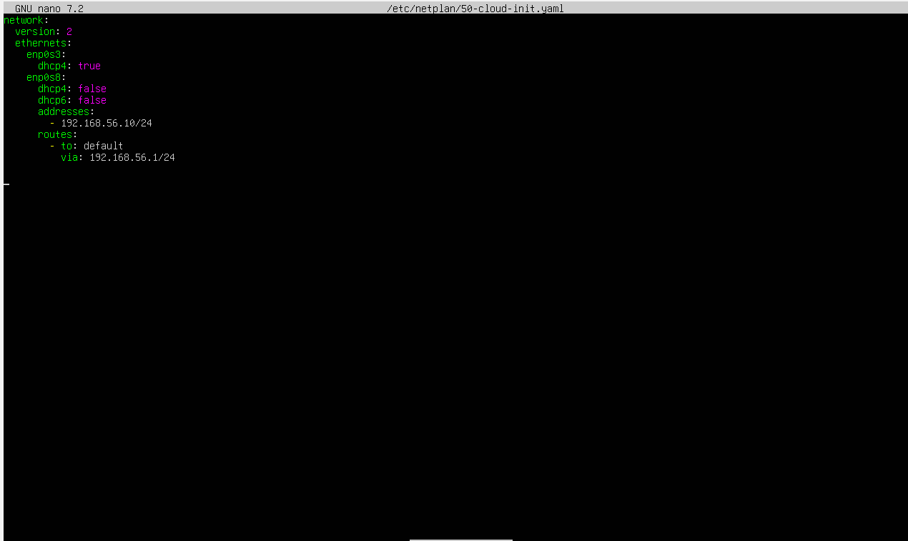
*Problème : route par défaut ajoutée à tort sur enp0s8*

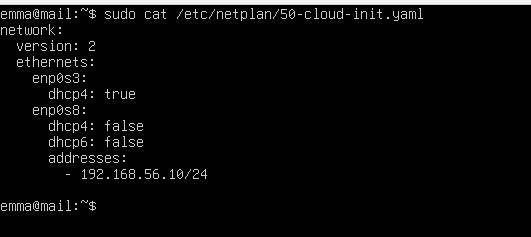
*Netplan corrigé : NAT en DHCP, réseau privé en adresse fixe*

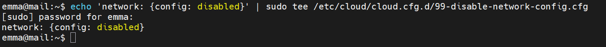
*cloud-init ne réécrit plus la configuration réseau*

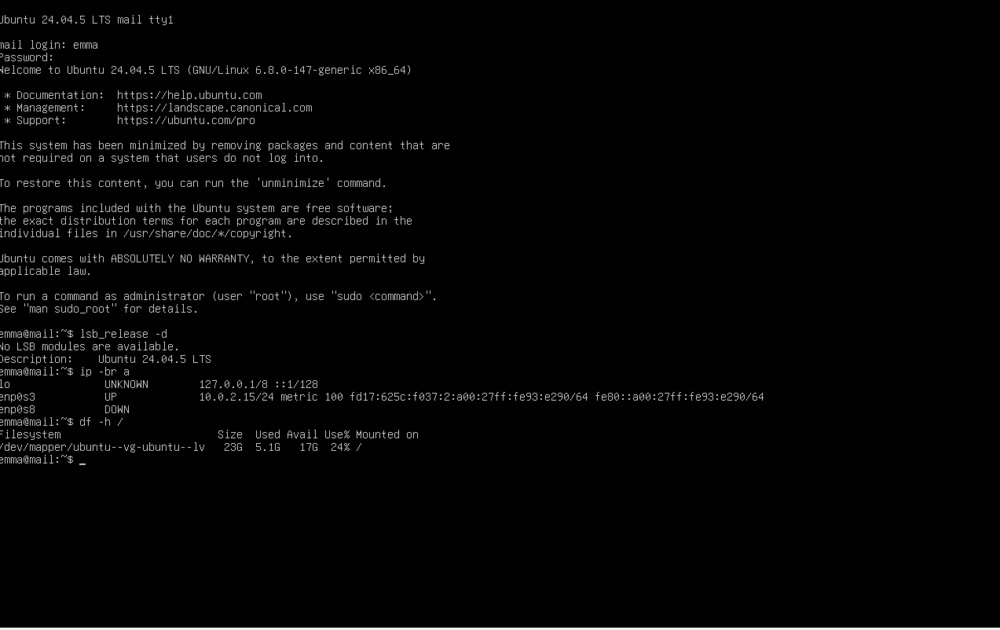
*Version du système, adresses, disque*

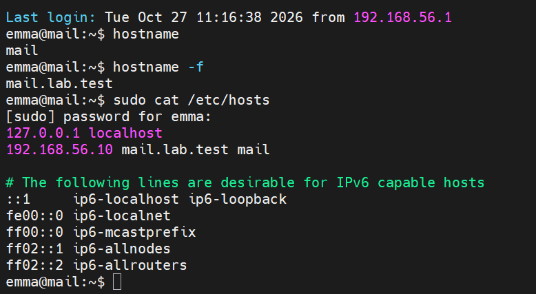
*Nom complet mail.lab.test*

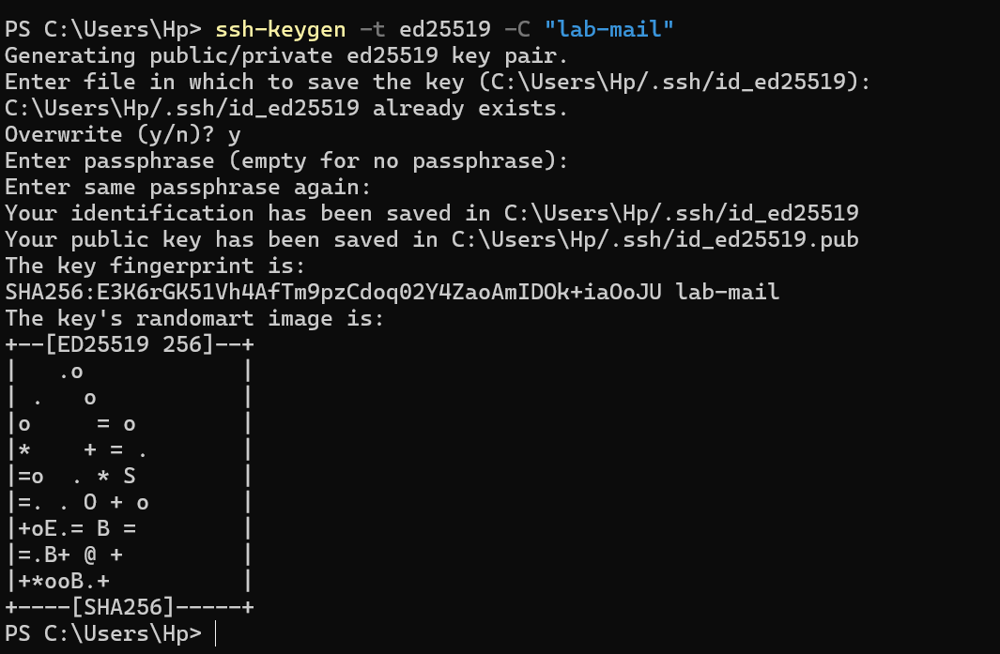
*Génération de la clé ed25519 sur Windows*

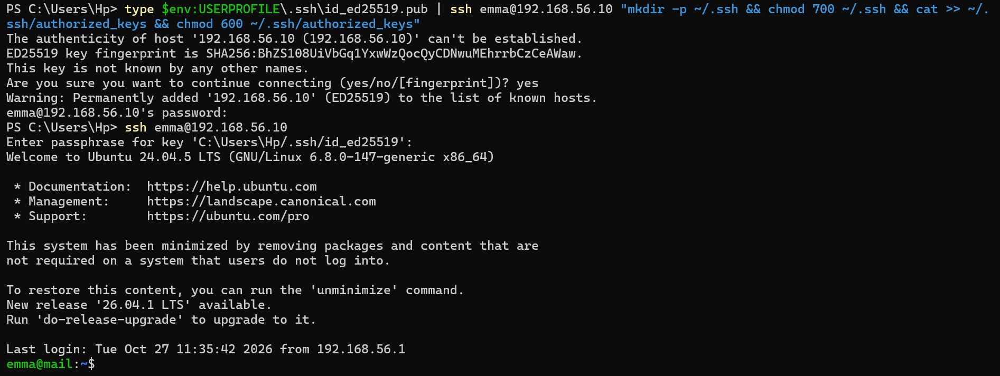
*Dépôt de la clé publique puis connexion par clé*

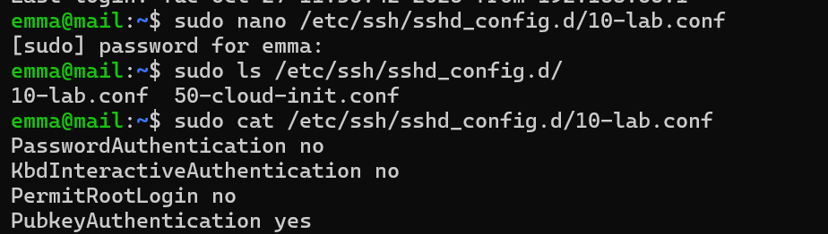
*SSH : mot de passe et root interdits*

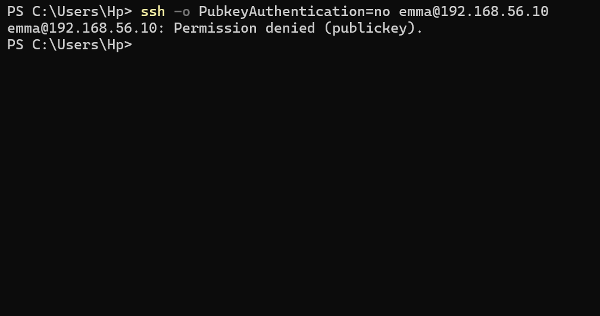
*Connexion par mot de passe refusée*

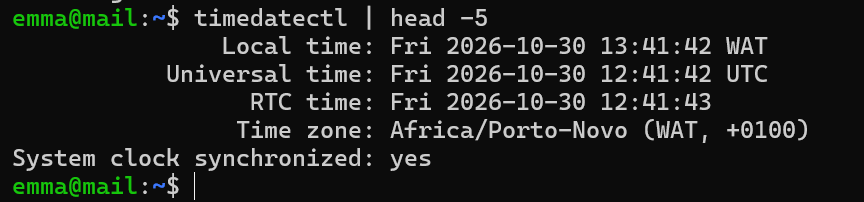
*Horloge synchronisée, fuseau Africa/Porto-Novo*
