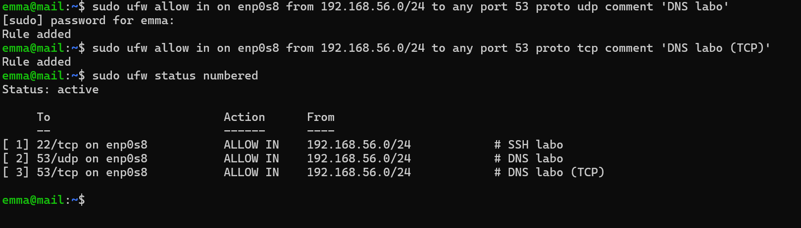
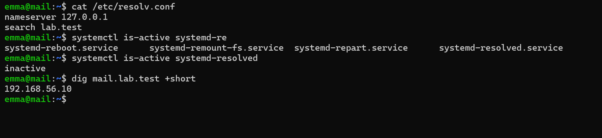
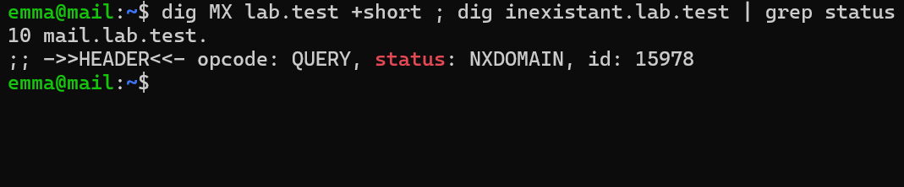
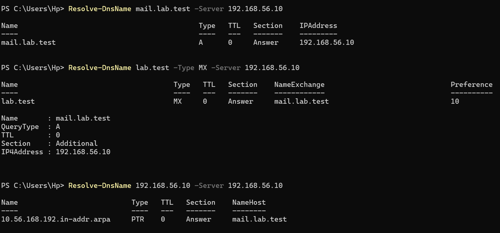

# Étape 3 — DNS local avec dnsmasq

**Objectif** : dnsmasq sur la VM `mail` sert les zones `lab.test` et `autre.test` (A, MX, PTR, CNAME), transmet le reste vers Internet et devient le résolveur de la VM.
**Instantané** : `03-dns`

## Ce qui a été fait

| Élément | Choix | Raison |
| --- | --- | --- |
| Logiciel | dnsmasq | Léger, un seul fichier de configuration |
| Écoute | `127.0.0.1` et `192.168.56.10`, `bind-interfaces` | Pas de conflit avec d'autres services sur le port 53 |
| Zones | `local=/lab.test/`, `local=/autre.test/` | Un nom inexistant reçoit `NXDOMAIN` au lieu d'être envoyé sur Internet |
| Enregistrements | `host-record` (A + PTR), `mx-host`, `cname` pour `webmail` | Le PTR de `192.168.56.10` reste unique : `mail.lab.test` |
| DNS amont | `10.0.2.3` (relais DNS de la carte NAT VirtualBox) | Suit automatiquement le réseau du poste hôte |
| Résolveur de la VM | `systemd-resolved` désactivé, `/etc/resolv.conf` fixe : `nameserver 127.0.0.1` | Une seule chaîne de résolution ; fichier simple pour le *chroot* de Postfix |
| Pare-feu | Port 53 UDP et TCP sur `enp0s8` | La VM `autre` interrogera ce DNS ; TCP pour les longues réponses TXT (DKIM) |

Configuration : [`configs/mail/dnsmasq/lab.conf`](../configs/mail/).

| Type | Exemple | Rôle pour la messagerie |
| --- | --- | --- |
| A | `mail.lab.test → 192.168.56.10` | Adresse d'un nom |
| MX | `lab.test → 10 mail.lab.test` | Serveur qui reçoit le courrier du domaine |
| PTR | `192.168.56.10 → mail.lab.test` | Résolution inverse, exigée en production |
| CNAME | `webmail.lab.test → mail.lab.test` | Alias, jamais cible d'un MX |
| TXT | SPF, DKIM, DMARC | Ajoutés à l'étape 10 |

## Vérifications

Voir [`tests/etape-03.md`](../tests/etape-03.md).

## Problèmes rencontrés et solutions

| Problème | Cause | Solution | À retenir |
| --- | --- | --- | --- |
| *(aucun problème bloquant)* | | | |

Choix notable : la configuration de dnsmasq a été écrite **avant** l'installation du paquet, pour qu'il démarre directement avec `bind-interfaces` sans entrer en conflit avec `systemd-resolved` sur le port 53.

## Ce que j'ai appris

- La différence entre `dig` (requête DNS directe) et `getent hosts` (résolution par la bibliothèque système, celle qu'utilisent Postfix et Dovecot).
- `log-queries` pour voir, ligne par ligne, ce que chaque service demande au DNS.
- Pourquoi une zone locale ne doit jamais être transmise à un DNS public.

## Captures

*Pare-feu : SSH et DNS ouverts sur le réseau du labo uniquement*

*Résolveur local, systemd-resolved désactivé, enregistrement A*

*MX de lab.test et zone fermée (NXDOMAIN)*

*Résolution A, MX et PTR depuis Windows*
