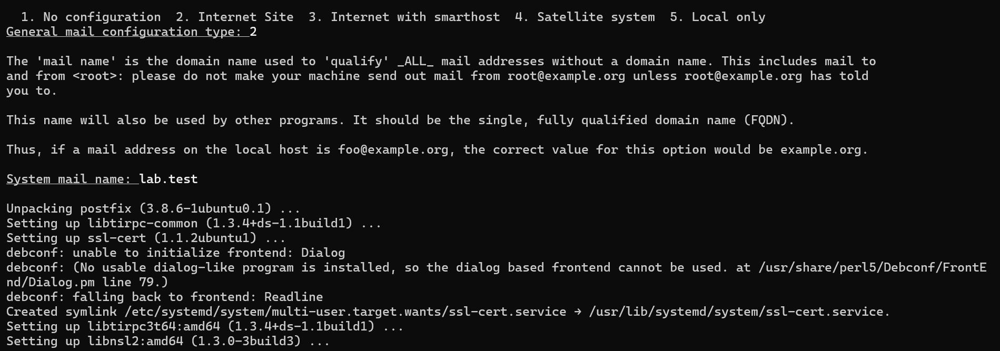
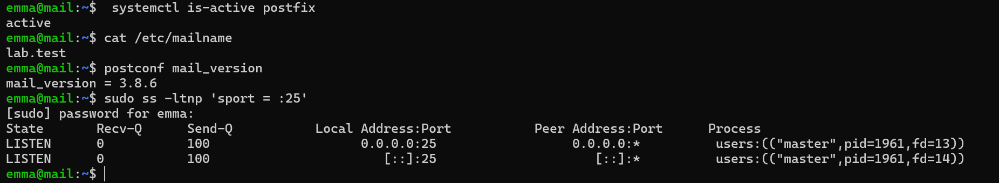
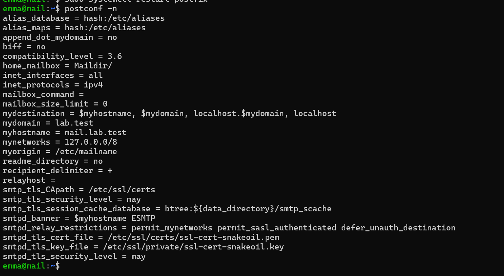
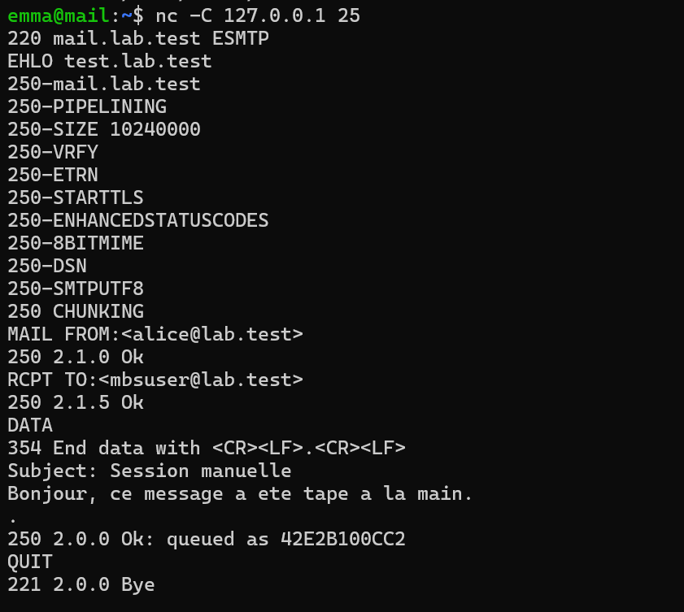
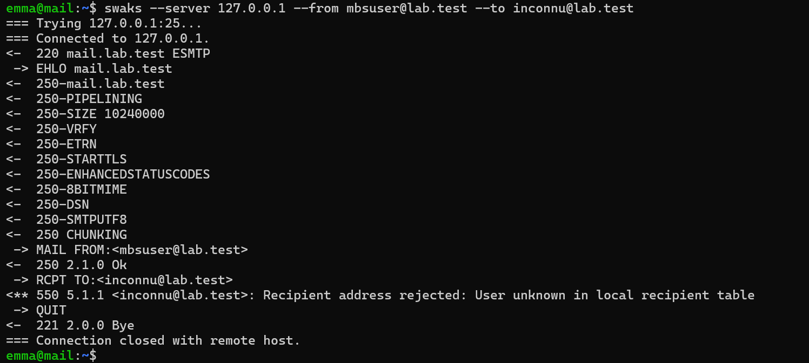
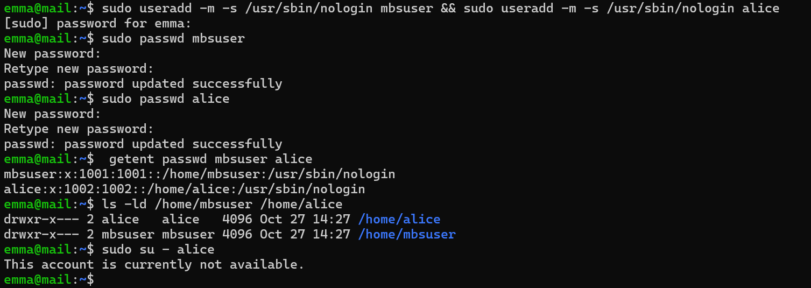
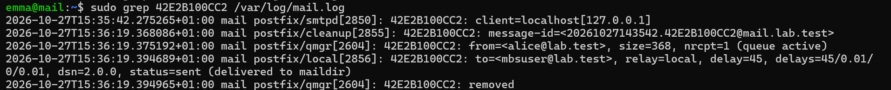
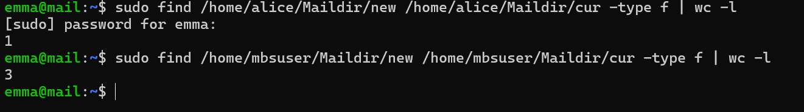
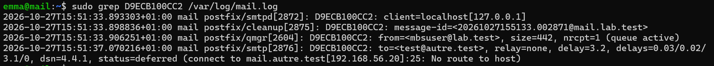
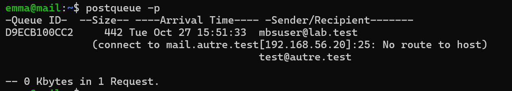

# Étape 4 — Postfix en livraison locale

**Objectif** : Postfix accepte le courrier pour `@lab.test` et le dépose au format Maildir dans le dossier personnel de comptes système de test.
**Instantané** : `04-postfix`

## Ce qui a été fait

| Paramètre | Valeur | Raison |
| --- | --- | --- |
| `myhostname` | `mail.lab.test` | Doit correspondre au A, au PTR et au MX |
| `mydestination` | `$myhostname, $mydomain, localhost.$mydomain, localhost` | Domaines livrés localement (modifié à l'étape 6) |
| `mynetworks` | `127.0.0.0/8` | Seule la VM elle-même peut relayer (ES1) |
| `inet_protocols` | `ipv4` | IPv6 hors du périmètre |
| `home_mailbox` | `Maildir/` | La barre oblique finale impose le format Maildir |
| `mailbox_command` | vide | Sinon, la commande l'emporte sur `home_mailbox` |
| `smtpd_banner` | `$myhostname ESMTP` | Ne révèle pas le système d'exploitation |
| `/etc/aliases` | `root: emma`, `postmaster: root` | `postmaster` est obligatoire (RFC 5321) |

Configuration : [`configs/mail/postfix/main.cf`](../configs/mail/).

Parcours d'un message : `smtpd` → `cleanup` → file d'attente → `qmgr` → `local` → `~/Maildir/new/`. L'identifiant de file d'attente relie toutes les lignes du journal.

## Erreurs provoquées volontairement

| Test | Résultat observé | Enseignement |
| --- | --- | --- |
| Destinataire inconnu | `550 5.1.1 … User unknown in local recipient table` | Refus dès `RCPT TO`, le message n'entre jamais dans la file |
| Serveur distant injoignable (`autre` pas encore créé) | `status=deferred (… No route to host)` | Le message attend dans la file et sera retenté |
| Domaine inexistant | `status=bounced (Host or domain name not found)` | Avis de non-remise renvoyé à l'expéditeur |

## Vérifications

Voir [`tests/etape-04.md`](../tests/etape-04.md).

## Problèmes rencontrés et solutions

| Problème | Cause | Solution | À retenir |
| --- | --- | --- | --- |
| *(aucun problème bloquant)* | | | |

## Ce que j'ai appris

- Postfix est une chaîne de petits processus, chacun visible dans le journal.
- La différence entre l'enveloppe (`MAIL FROM`, `RCPT TO`) et les en-têtes (`From:`, `To:`).
- Les commandes de la file : `postqueue -p`, `postcat -q`, `postsuper -d`.

## Captures

*Installation de Postfix*

*Postfix actif, version 3.8.6, à l'écoute sur 25*

*Configuration effective de Postfix*

*Session SMTP tapée à la main*

*Destinataire inconnu refusé (550 5.1.1)*

*Comptes système de test (supprimés à l'étape 6)*

*Livraison locale dans le Maildir*

*Messages présents dans les Maildir*

*Message vers autre.test en attente : No route to host*

*File d'attente avec le message différé*
