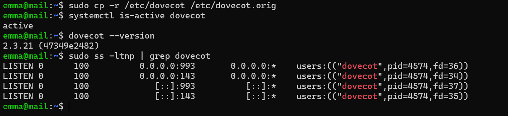
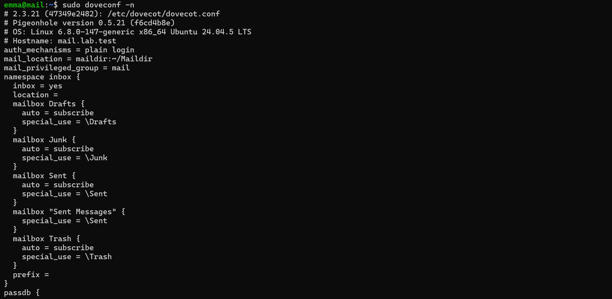
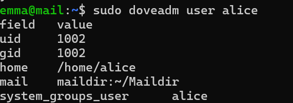
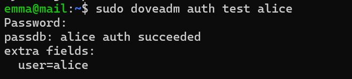
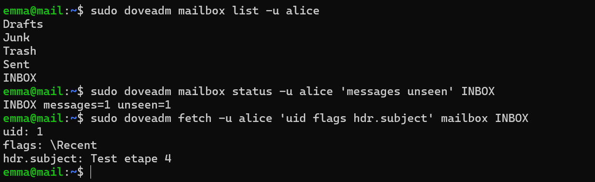
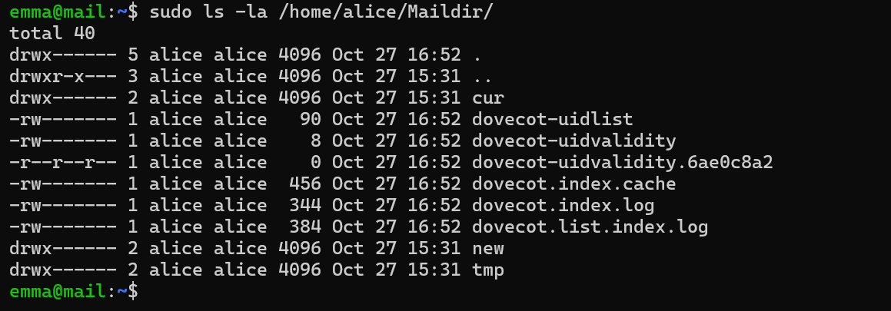
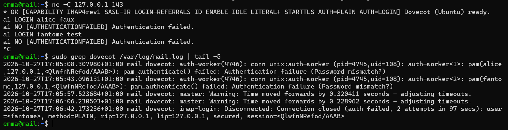
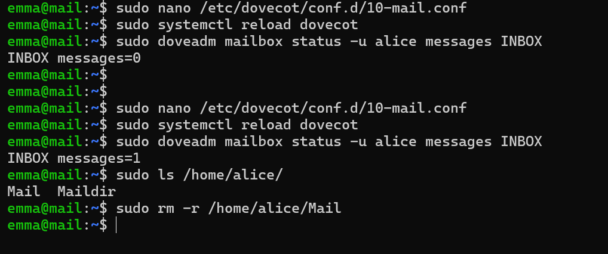

# Étape 5 — Dovecot et IMAP

**Objectif** : Dovecot présente en IMAP les Maildir remplis par Postfix ; les comptes s'authentifient par PAM.
**Instantané** : `05-dovecot`

## Ce qui a été fait

| Réglage | Valeur | Raison |
| --- | --- | --- |
| `mail_location` | `maildir:~/Maildir` | Exactement le dossier où Postfix livre |
| `disable_plaintext_auth` | `yes` | Mot de passe en clair refusé sans TLS, sauf depuis la VM elle-même |
| `auth_mechanisms` | `plain login` | `LOGIN` reste exigé par certains clients |
| Dossiers spéciaux | `Drafts`, `Junk`, `Trash`, `Sent` en `auto = subscribe` | Créés à la première connexion, reconnus par les clients via `special_use` |
| `auth_verbose` | `yes` | Échecs détaillés, utilisés par Fail2ban à l'étape 11 |

Configuration : [`configs/mail/dovecot/`](../configs/mail/).

Observation : à l'ouverture de la boîte (`SELECT`), les messages passent de `new/` à `cur/` ; marquer un message comme lu ajoute `:2,S` à son nom de fichier.

## Erreurs provoquées volontairement

| Test | Résultat observé | Enseignement |
| --- | --- | --- |
| Mauvais mot de passe | `NO [AUTHENTICATIONFAILED]` ; journal : `pam_authenticate() failed` | |
| Utilisateur inexistant | Même réponse que pour un mauvais mot de passe | Dovecot ne révèle pas quels comptes existent |
| `mail_location` vers `~/Mail` | Boîte vide alors que les fichiers sont sur le disque | Postfix et Dovecot doivent pointer vers le même dossier |

## Vérifications

Voir [`tests/etape-05.md`](../tests/etape-05.md).

## Problèmes rencontrés et solutions

| Problème | Cause | Solution | À retenir |
| --- | --- | --- | --- |
| *(aucun problème bloquant)* | | | |

## Ce que j'ai appris

- Une session IMAP à la main : `LOGIN`, `LIST`, `SELECT`, `FETCH … BODY.PEEK`, `STORE +FLAGS`.
- `doveadm` comme premier outil de diagnostic (`user`, `auth test`, `mailbox status`, `fetch`).
- La livraison Maildir est atomique : écriture dans `tmp/`, puis déplacement dans `new/`.

## Captures

*Dovecot 2.3.21 actif, ports 143 et 993*

*Configuration effective de Dovecot*

*Utilisateur système alice vu par Dovecot*

*Authentification réussie*

*Dossiers spéciaux et message lu par doveadm*

*Maildir d'alice : dossiers 700, fichiers 600*

*Échecs IMAP volontaires et journal correspondant*

*Problème : mauvais mail_location, INBOX vide*
