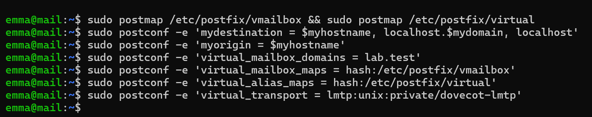
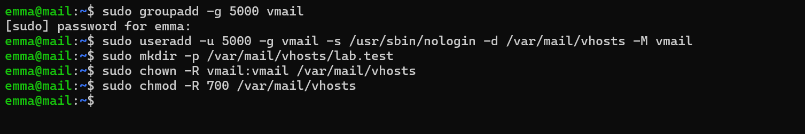
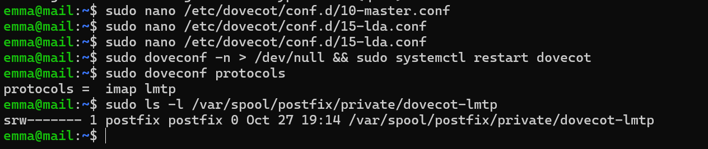
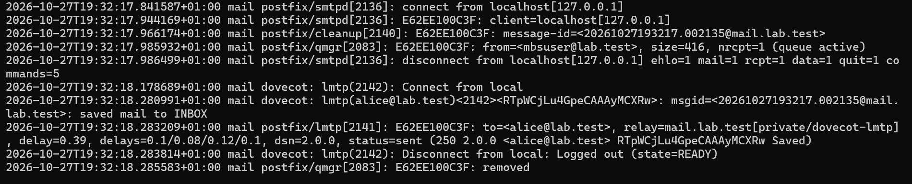
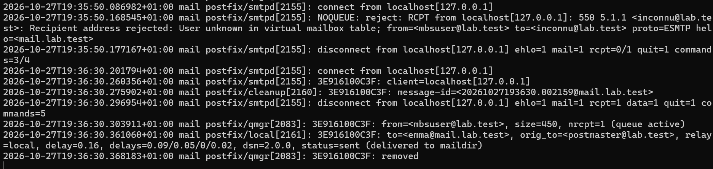
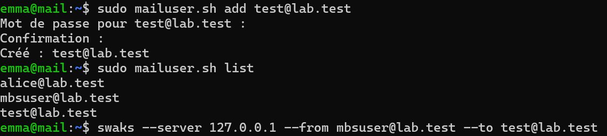
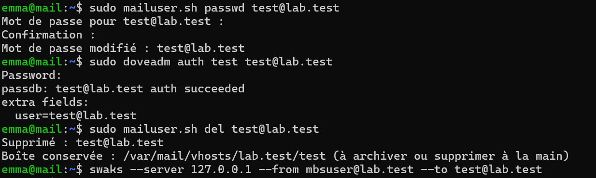
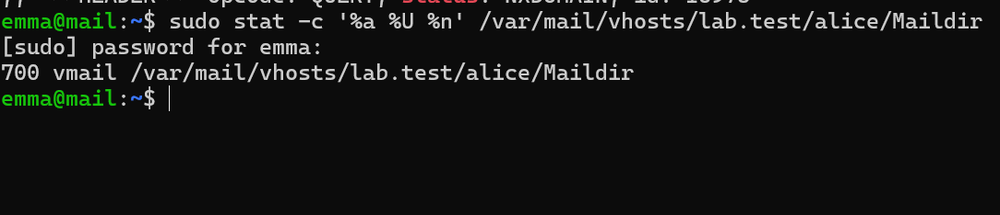
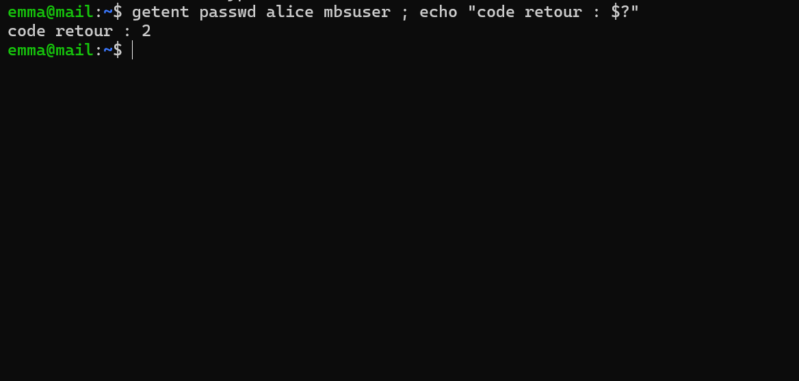

# Étape 6 — Utilisateurs virtuels et LMTP

**Objectif** : les boîtes ne dépendent plus de comptes Linux ; un seul propriétaire, `vmail`, et une livraison par Dovecot via LMTP.
**Instantané** : `06-virtuels`

## Avant / après

| Aspect | Avant (étapes 4 et 5) | Après |
| --- | --- | --- |
| Définition des utilisateurs | `/etc/passwd` | `/etc/dovecot/users` |
| Identifiant de connexion | `alice` | `alice@lab.test` |
| Mot de passe | PAM | Hash BLF-CRYPT dans le fichier de Dovecot |
| Propriétaire des Maildir | Chaque utilisateur | `vmail` (UID/GID 5000) |
| Emplacement | `/home/alice/Maildir` | `/var/mail/vhosts/lab.test/alice/Maildir` |
| `lab.test` pour Postfix | `mydestination` | `virtual_mailbox_domains` |
| Qui écrit dans le Maildir | Postfix `local` | Dovecot via LMTP |
| Destinataires valides | Comptes système | `/etc/postfix/vmailbox` |
| Ajouter un utilisateur | `useradd` + `passwd` | [`scripts/mailuser.sh`](../scripts/mailuser.sh) `add` |

Configuration : [`configs/mail/dovecot/conf.d/auth-lab.conf.ext`](../configs/mail/), [`configs/mail/postfix/`](../configs/mail/).

Migration dans l'ordre : compte `vmail` → fichier des utilisateurs → copie des boîtes (`cp -a`, drapeaux conservés) → LMTP → bascule de Postfix → tests → suppression des comptes système. État de départ noté : 1 message pour `alice`, 3 pour `mbsuser`, retrouvés après migration.

## Vérifications

Voir [`tests/etape-06.md`](../tests/etape-06.md).

## Problèmes rencontrés et solutions

| Problème | Cause | Solution | À retenir |
| --- | --- | --- | --- |
| `doveadm pw -s alice` → `Unknown scheme: ALICE` | `-s` attend un algorithme de hachage, pas un utilisateur | `doveadm pw -s BLF-CRYPT`, puis association manuelle hash ↔ adresse dans le fichier | Lire ce qu'attend une option avant de l'utiliser |
| `userdel -r` : `mail spool (/var/mail/alice) not found` | `userdel` cherche aussi une ancienne boîte mbox, qui n'a jamais existé | Avertissement sans conséquence, compte bien supprimé | Distinguer un avertissement d'une erreur |
| `doveadm … INBO` → `Mailbox doesn't exist` | Faute de frappe | `INBOX` | Le message d'erreur cite exactement ce qui a été tapé |

## Ce que j'ai appris

- Pourquoi la production utilise des utilisateurs virtuels : sécurité (aucun compte système) et administration (un fichier, un script).
- Les variables de Dovecot `%Lu`, `%Ld`, `%Ln`.
- Garder deux listes synchronisées (Postfix, Dovecot) grâce à un script unique.

## Captures

*Domaine virtuel et transport LMTP*

*Utilisateur vmail (UID/GID 5000)*

*Socket LMTP de Dovecot dans la prison Postfix*

*Livraison LMTP : saved mail to INBOX*

*Destinataire inconnu (550) et alias postmaster*

*mailuser.sh : création et liste*

*mailuser.sh : mot de passe, test, suppression*

*Maildir virtuel : 700 vmail*

*Plus aucun compte système pour les boîtes*
