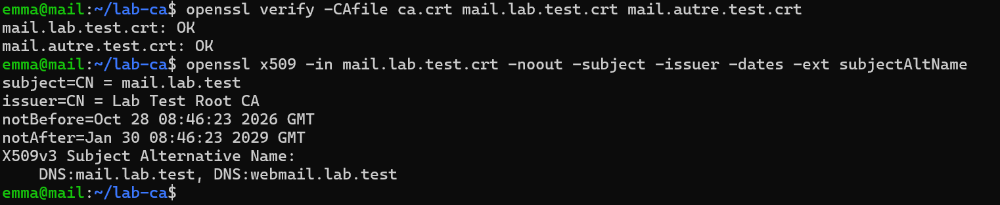
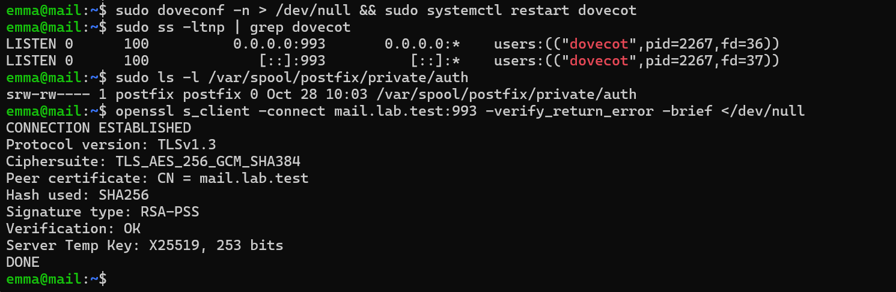
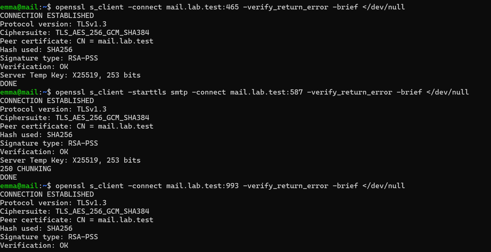
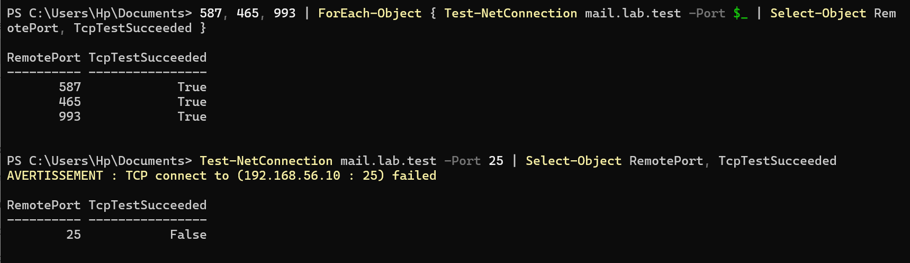
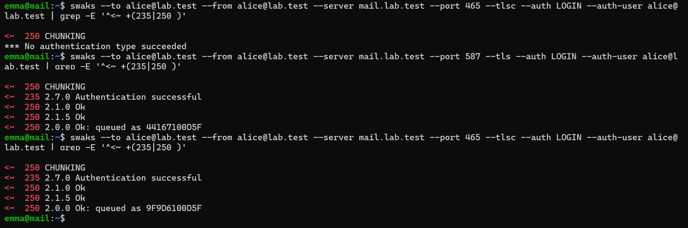
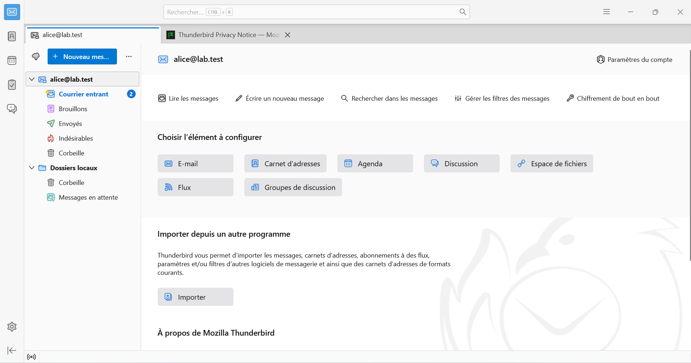

# Étape 7 — CA locale, TLS et authentification SMTP

**Objectif** : certificats signés par une CA OpenSSL du labo ; envoi sur 587 (STARTTLS) et 465 (TLS implicite) après authentification par Dovecot ; IMAPS seul ; aucun relais non authentifié.
**Instantané** : `07-tls-sasl`

## Ce qui a été fait

| Élément | Choix | Raison |
| --- | --- | --- |
| CA | RSA 3072 bits, clé chiffrée AES-256, 10 ans, `CA:TRUE` | Racine de confiance du labo |
| Certificats serveur | RSA 2048, 825 jours, `serverAuth` ; SAN `mail.lab.test` + `webmail.lab.test`, et `mail.autre.test` | Les clients vérifient le SAN, pas le CN |
| Clé de la CA | Copiée sur le poste hôte, puis effacée de la VM (`shred -u`) | Elle permet de signer n'importe quel nom |
| Confiance | CA installée sur la VM (`update-ca-certificates`) et sur Windows (`Cert:\CurrentUser\Root`) | Vérification sans avertissement |
| Dovecot | `ssl_min_protocol = TLSv1.2`, IMAP 143 fermé (`port = 0`), socket `private/auth` pour Postfix | ES2 |
| Postfix, port 25 | `smtpd_tls_security_level = may` | TLS opportuniste entre serveurs, comme en production |
| Postfix, 587/465 | `encrypt` / `wrappermode`, `sasl_auth_enable=yes`, `permit_sasl_authenticated,reject` | Envoi réservé aux utilisateurs authentifiés |
| Anti-relais | `reject_unauth_destination` | Refus définitif `554` plutôt que temporaire `454` |
| Pare-feu | 465, 587, 993 ouverts au labo ; 25 encore fermé | Ouvert à l'étape 8 |

Configuration : [`configs/mail/postfix/master.cf`](../configs/mail/), [`configs/mail/dovecot/conf.d/10-ssl.conf`](../configs/mail/).

## Vérifications

Voir [`tests/etape-07.md`](../tests/etape-07.md).

| Test refusé | Réponse du serveur |
| --- | --- |
| Relais depuis `192.168.56.10` vers `example.com` | `554 5.7.1 Relay access denied` |
| 587 sans authentification | `554 5.7.1 … Access denied` |
| 587 sans STARTTLS | `530 5.7.0 Must issue a STARTTLS command first` |
| Mauvais mot de passe | `535 5.7.8 Error: authentication failed` |

## Problèmes rencontrés et solutions

| Problème | Cause | Solution | À retenir |
| --- | --- | --- | --- |
| `Test-NetConnection mail.lab.test` : `Name resolution failed`, `RemotePort 0` | Le poste Windows ne connaissait pas le nom | Ajout de `mail.lab.test` et `webmail.lab.test` au fichier `hosts` de Windows, `ipconfig /flushdns` | Le certificat est émis pour un **nom** : il faut s'y connecter par ce nom |
| Copie de fichiers depuis la VM sans MobaXterm | Outil changé en cours de projet | `scp` intégré à Windows | `ssh` et `scp` suffisent, sans outil tiers |
| Port 25 : `TcpTestSucceeded False` | Attendu : fermé jusqu'à l'étape 8 | — | Un échec peut être le résultat recherché |

## Ce que j'ai appris

- La chaîne de confiance : CA → certificat serveur → client qui fait confiance à la CA.
- La différence entre STARTTLS et TLS implicite, et entre ports « serveurs » et ports « utilisateurs ».
- Pourquoi Postfix délègue l'authentification à Dovecot : une seule source de comptes.

## Captures

*Certificats vérifiés par la CA, SAN mail et webmail*

*IMAP 143 fermé, socket SASL, IMAPS vérifié*

*TLS 1.3 vérifié sur 465, 587 et 993*

*Ports clients ouverts, 25 fermé depuis Windows*

*Envoi authentifié sur 587 et 465 (saisie masquée)*

*Compte alice@lab.test dans Thunderbird*
