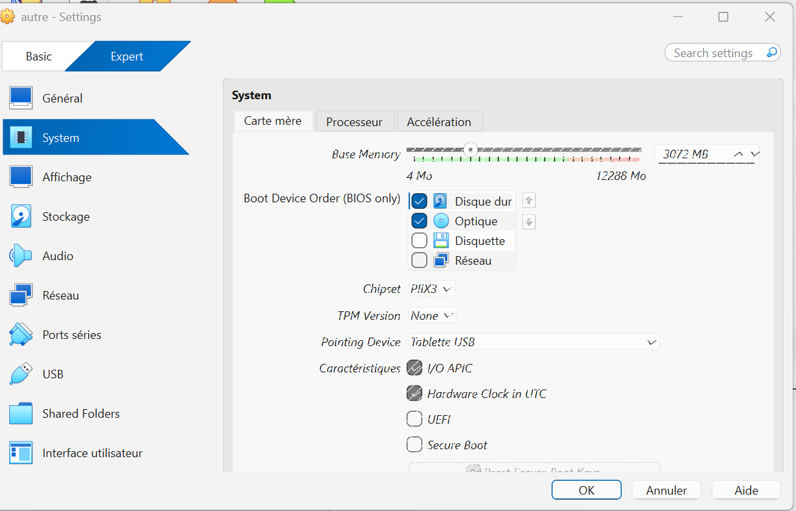
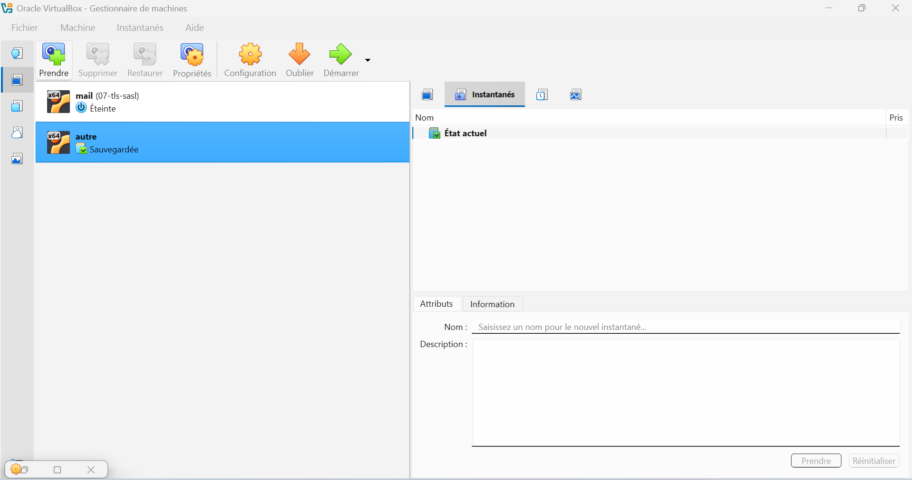
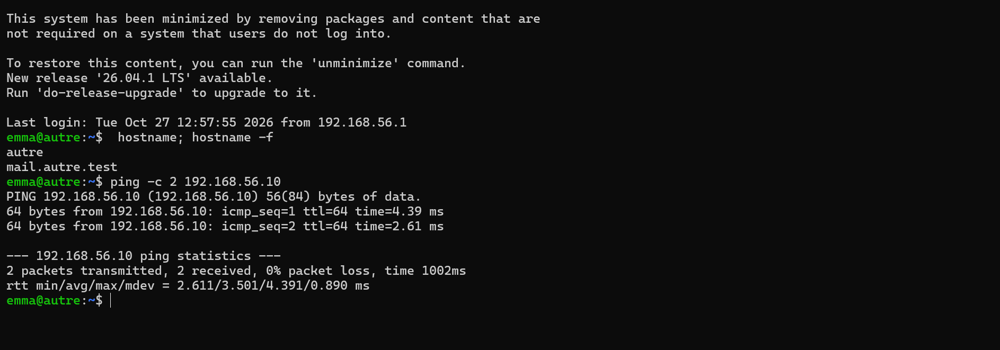
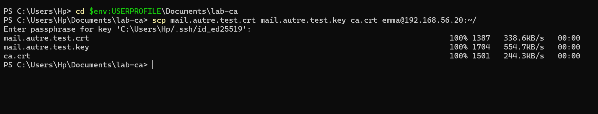
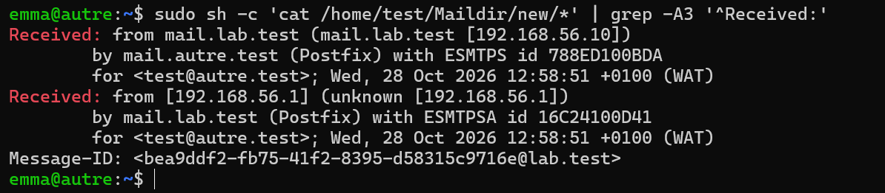
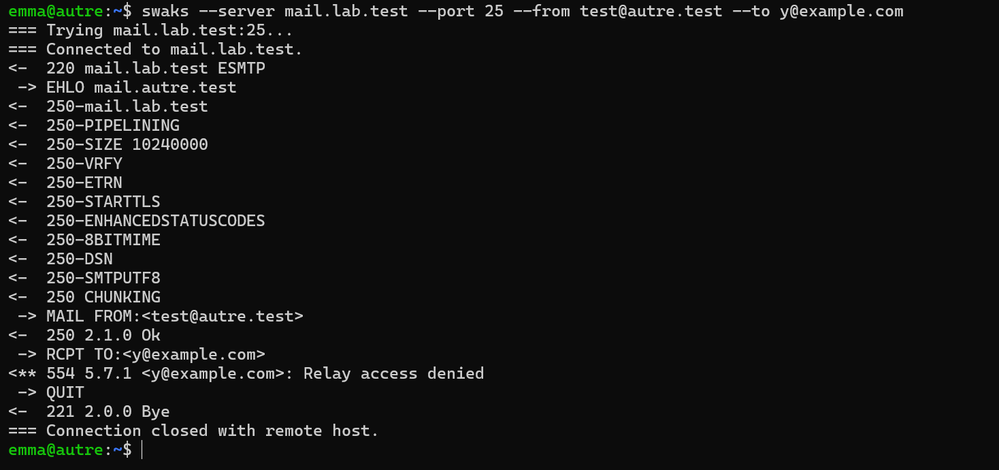

# Étape 8 — Second domaine et échanges entre serveurs

**Objectif** : une seconde VM, `mail.autre.test`, échange du courrier avec `mail.lab.test` sur le port 25, chiffré, après résolution du MX ; le non-relais est vérifié depuis une machine étrangère.
**Instantanés** : `08-deux-domaines` sur les deux VM

## Ce qui a été fait

| Élément | Choix | Raison |
| --- | --- | --- |
| Création | Clone intégral de `02-base`, nouvelles adresses MAC | Système déjà à jour, sans services de messagerie |
| Identité | IP `192.168.56.20`, nom `autre`, FQDN `mail.autre.test`, nouveaux `machine-id` et clés d'hôte SSH | Un clone est une copie exacte qu'il faut rendre unique |
| DNS | `resolv.conf` → `192.168.56.10` | Comme un serveur qui utilise le résolveur de son hébergeur |
| Postfix | Livraison locale, compte `test` sans shell, TLS avec le certificat `mail.autre.test` | Serveur volontairement simple |
| Pare-feu | Port 25 ouvert au labo sur les deux VM | |

Configuration : [`configs/autre/postfix/main.cf`](../configs/autre/).

Lecture des en-têtes `Received:` d'un message de Thunderbird vers `test@autre.test`, de bas en haut :

```text
Received: from mail.lab.test (mail.lab.test [192.168.56.10]) by mail.autre.test (Postfix) with ESMTPS …
Received: from [192.168.56.1] … by mail.lab.test (Postfix) with ESMTPSA …
```

`ESMTPSA` : chiffré et authentifié (le client) ; `ESMTPS` : chiffré, sans authentification (entre serveurs).

Reprise après panne : Postfix arrêté sur `autre`, message conservé dans la file de `mail`, livré après redémarrage et `postqueue -f`.

## Vérifications

Voir [`tests/etape-08.md`](../tests/etape-08.md).

## Problèmes rencontrés et solutions

| Problème | Cause | Solution | À retenir |
| --- | --- | --- | --- |
| Réglages du clone grisés, état « Sauvegardée » | L'instantané `02-base` avait été pris VM allumée : le clone a hérité de l'état mémoire | **Oublier** l'état sauvegardé | Prendre les instantanés VM éteinte |
| `nc: command not found` sur `autre` | `netcat-openbsd` installé sur `mail` après l'instantané cloné | Installation du paquet | Un clone ne contient que ce qui existait au moment de l'instantané |
| `sudo cat /home/test/Maildir/new/*` : `No such file` | L'étoile est développée par le shell d'`emma` avant `sudo`, sans droit de lecture sur le dossier | `sudo sh -c 'cat …/*'` | Avec `sudo`, les motifs du shell sont évalués avec les droits de l'utilisateur appelant |
| Test facultatif `smtp_tls_policy_maps` à annuler | — | `postconf -X smtp_tls_policy_maps`, suppression des fichiers | `postconf -X` retire un paramètre de `main.cf` |
| `ssh-keygen -F` lancé sur la VM au lieu du poste | Confusion sur l'emplacement de `known_hosts` | Comparaison des empreintes avec `ssh-keygen -lf /etc/ssh/ssh_host_ed25519_key.pub` sur chaque VM | Chaque machine a son propre `known_hosts` |

## Ce que j'ai appris

- Un serveur ne livre pas « à une adresse » mais au MX du domaine.
- Cloner une VM impose de régénérer son identité.
- La différence entre une connexion TLS `Trusted` (chaîne valide) et `Verified` (chaîne et nom vérifiés).

## Captures


*Problème : réglages du clone grisés*


*Cause : clone dans l'état « Sauvegardée »*


*Identité du clone et accès à mail*


*Copie du certificat de autre depuis Windows*


*Trajet : ESMTPSA puis ESMTPS*


*Relais refusé depuis autre (554 5.7.1)*
