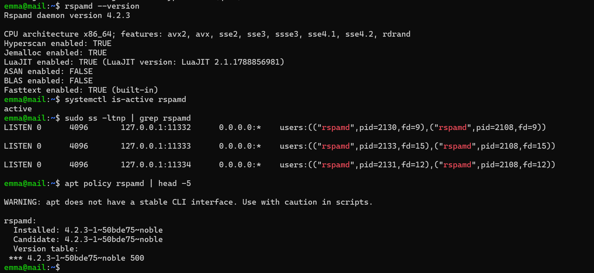
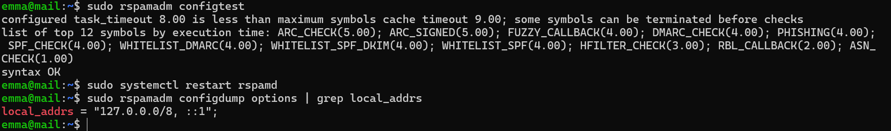
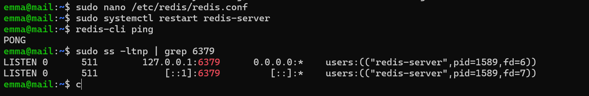
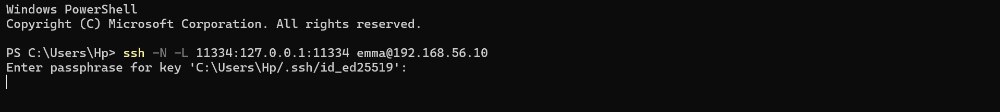
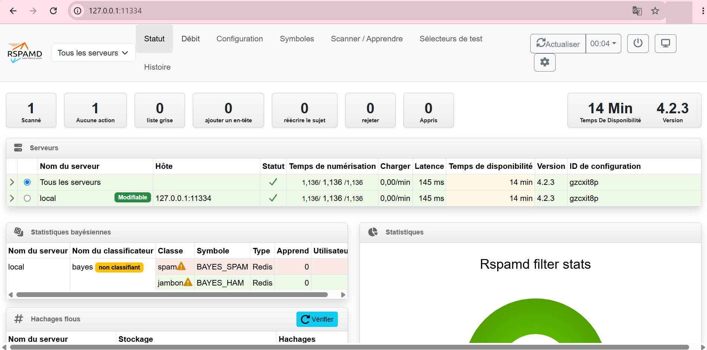
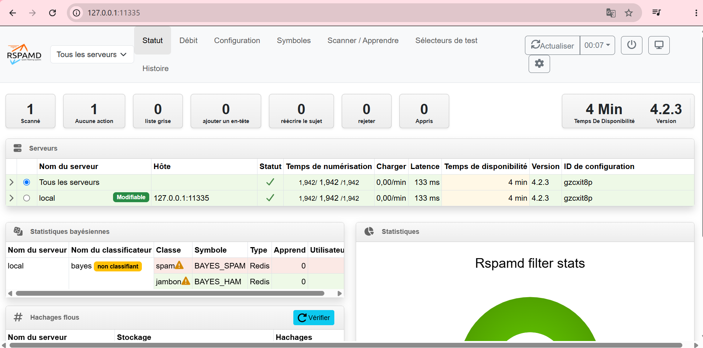
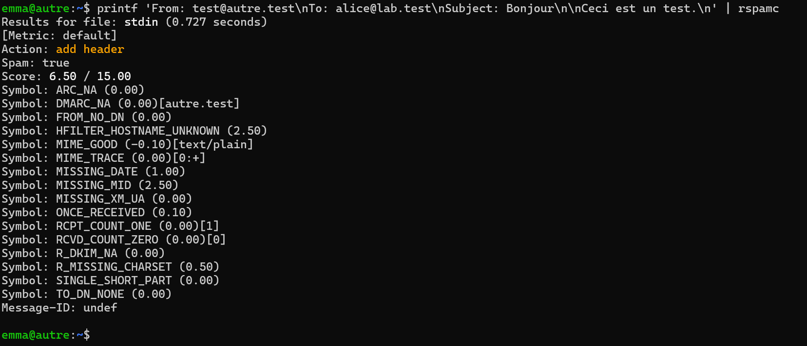
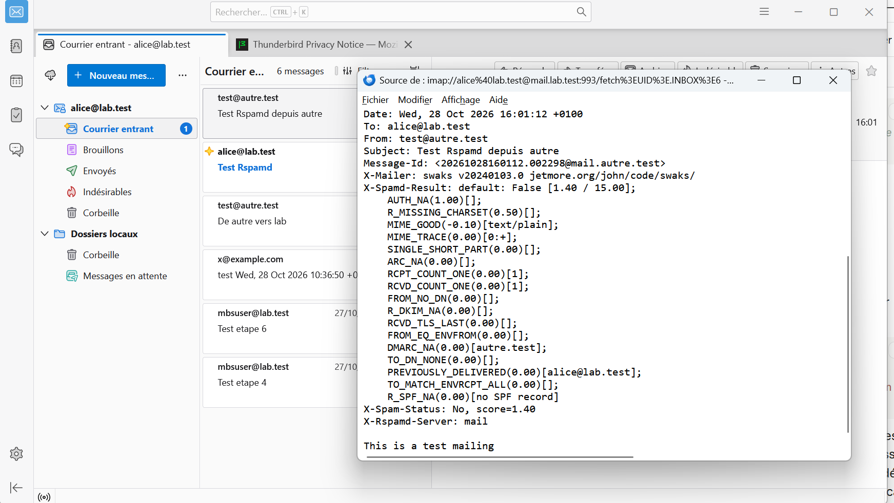
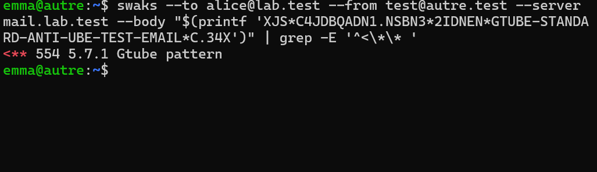

# Étape 9 — Filtrage anti-spam avec Rspamd et Redis

**Objectif** : chaque message entrant ou sortant est analysé par Rspamd avant d'être accepté ; le message de test GTUBE est rejeté.
**Instantanés** : `09-rspamd` sur les deux VM

## Ce qui a été fait

| Élément | Choix | Raison |
| --- | --- | --- |
| Paquet | Dépôt officiel `rspamd.com/apt-stable`, clé limitée au dépôt (`signed-by`) | Version d'Ubuntu nettement plus ancienne |
| Redis | `bind 127.0.0.1`, `maxmemory` 128 Mo (`mail`) / 64 Mo (`autre`) | Pas de mot de passe : jamais exposé ; mémoire limitée |
| Configuration | Uniquement dans `/etc/rspamd/local.d/` | Survit aux mises à jour |
| `local_addrs` | `127.0.0.0/8, ::1` | Les deux VM partagent un réseau privé ; sans ce réglage, `autre` serait jugée locale |
| En-têtes | `X-Spamd-Result`, `X-Rspamd-Server`, `X-Spam-Status`, `Authentication-Results` | Rendre l'analyse visible |
| Postfix | `smtpd_milters = inet:127.0.0.1:11332`, `milter_default_action = accept` | Compromis documenté dans [SECURITY.md](../SECURITY.md) |
| Interface | `127.0.0.1:11334`, tunnel `ssh -L` depuis le poste | ES6 |

Configuration : [`configs/mail/rspamd/local.d/`](../configs/mail/).

| Score par défaut | Action |
| --- | --- |
| < 4 | Aucune |
| ≥ 4 | `greylist` |
| ≥ 6 | `add header` (spam marqué) |
| ≥ 15 | `reject` |

Message de référence avant l'étape 10 : score **1,40** ; `AUTH_NA`, `R_SPF_NA`, `DMARC_NA` ; `Authentication-Results: dkim=none; spf=none; dmarc=none`.

## Vérifications

Voir [`tests/etape-09.md`](../tests/etape-09.md).

## Problèmes rencontrés et solutions

| Problème | Cause | Solution | À retenir |
| --- | --- | --- | --- |
| Un seul en-tête `X-Rspamd-Server: mail` dans un message venu d'`autre` | Rspamd sur `mail` **supprime** les en-têtes d'analyse venus de l'extérieur avant d'ajouter les siens | Trace de l'analyse par `autre` retrouvée dans son journal (`LOCAL_OUTBOUND`) | Un serveur ne fait confiance qu'à ses propres conclusions : un spammeur ne peut pas se déclarer « non spam » |

## Ce que j'ai appris

- Un filtre additionne des indices (symboles) en un score, puis applique une action selon des seuils.
- Le protocole milter : Postfix applique la décision de Rspamd pendant la session SMTP.
- Pourquoi refuser pendant la session plutôt qu'après : pas d'avis de non-remise vers de fausses adresses.

## Captures

*Rspamd 4.2.3 du dépôt officiel, en écoute locale*

*configtest et local_addrs*

*Redis local*

*Tunnel SSH vers l'interface*

*Interface Rspamd de mail*

*Interface Rspamd de autre*

*Analyse d'un message incomplet par rspamc*

*En-têtes ajoutés par Rspamd (avant SPF)*

*Message GTUBE rejeté*
