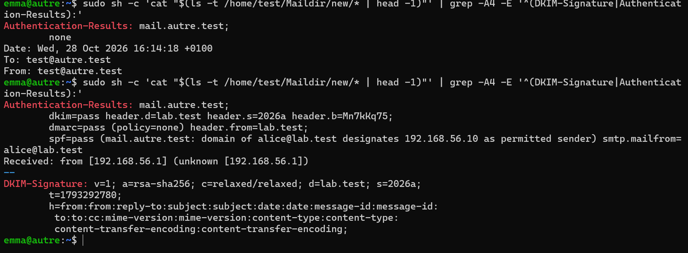
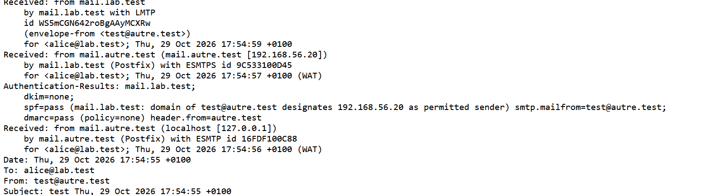
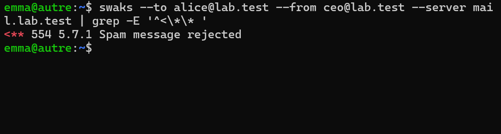

# Étape 10 — SPF, DKIM et DMARC

**Objectif** : le courrier de `lab.test` est signé DKIM ; le DNS publie SPF, clé DKIM et DMARC ; `autre` affiche `spf=pass dkim=pass dmarc=pass` et rejette une usurpation de `lab.test`.
**Instantanés** : `10-spf-dkim-dmarc` sur les deux VM

## Ce qui a été fait

| Enregistrement | Valeur | Rôle |
| --- | --- | --- |
| `lab.test TXT` | `v=spf1 mx -all` | Seuls les MX du domaine peuvent envoyer pour lui |
| `2026a._domainkey.lab.test TXT` | `v=DKIM1; k=rsa; p=…` (clé RSA 2048, découpée en chaînes de 250 caractères) | Clé publique de signature |
| `_dmarc.lab.test TXT` | `v=DMARC1; p=reject; adkim=s; aspf=s; rua=mailto:postmaster@lab.test` | Politique finale, alignement strict |
| `autre.test` | SPF `mx -all`, DMARC `p=none` | Domaine de test non signé |

| Côté Rspamd | Réglage |
| --- | --- |
| Signature (`mail`) | `dkim_signing.conf` : sélecteur `2026a`, clé `/var/lib/rspamd/dkim/lab.test.2026a.key` (`440 _rspamd`), `allow_username_mismatch = false` |
| Application de la politique (les deux VM) | `dmarc.conf` : `quarantine → add_header`, `reject → reject` |

Configuration : [`configs/mail/dnsmasq/lab.conf`](../configs/mail/), [`configs/mail/rspamd/local.d/`](../configs/mail/).

Progression suivie, comme en production : `p=none` (observer) → `p=reject`.

## Avant / après

```text
# Étape 9
Authentication-Results: mail.lab.test; dkim=none; spf=none …; dmarc=none

# Étape 10, message d'alice@lab.test reçu par autre.test
DKIM-Signature: v=1; a=rsa-sha256; … d=lab.test; s=2026a; …
Authentication-Results: mail.autre.test;
	dkim=pass header.d=lab.test header.s=2026a;
	spf=pass (… designates 192.168.56.10 as permitted sender) smtp.mailfrom=alice@lab.test;
	dmarc=pass (policy=reject) header.from=lab.test
```

<!-- Remplace ce bloc par les en-têtes réels de ton message. -->

| Usurpation de `alice@lab.test` depuis `192.168.56.20` | Résultat |
| --- | --- |
| Avec `p=none` | Acceptée, `spf=fail`, `dmarc=fail (policy=none)` |
| Avec `p=reject` | `554 5.7.1` ; Rspamd : `DMARC_POLICY_REJECT` |

## Vérifications

Voir [`tests/etape-10.md`](../tests/etape-10.md).

## Problèmes rencontrés et solutions

| Problème | Cause | Solution | À retenir |
| --- | --- | --- | --- |
| `/etc/dnsmasq.d` introuvable sur `autre` | Le DNS des deux domaines n'est servi que par `mail` | Enregistrements ajoutés sur `mail`, vérifiés depuis `autre` avec `dig` | Savoir où se trouve la source de vérité d'une donnée |

## Ce que j'ai appris

- SPF contrôle l'adresse IP, DKIM l'intégrité et le domaine signataire, DMARC l'alignement avec le `From:`.
- Le domaine émetteur publie ses règles ; c'est le destinataire qui les applique.
- Un seul mécanisme aligné suffit à DMARC.

## Captures


*Vu par autre : dkim, spf et dmarc pass*


*Vu par mail : message de autre.test*


*Usurpation de lab.test refusée*
