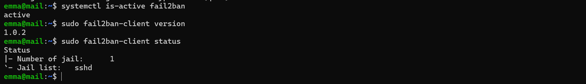
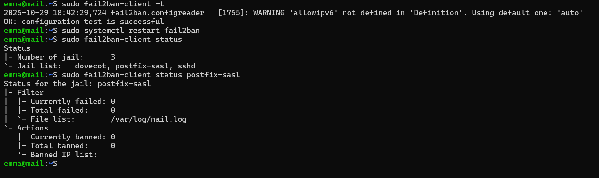
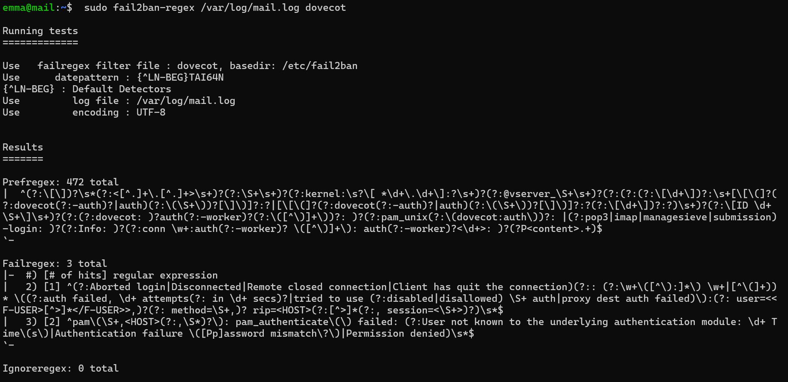
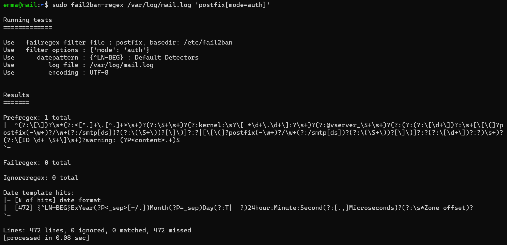
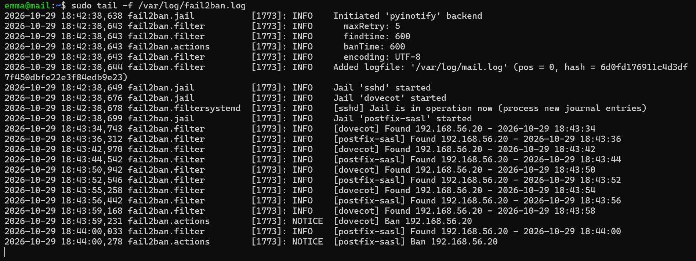
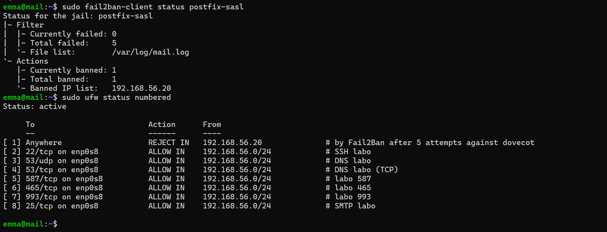
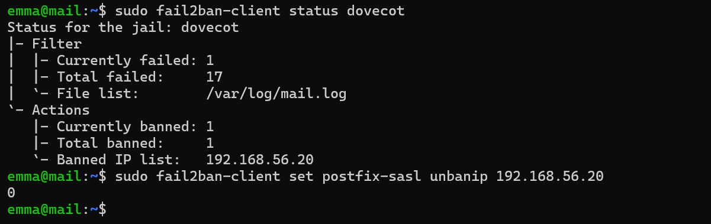

# Étape 11 — Fail2ban contre la force brute

**Objectif** : cinq échecs d'authentification en dix minutes bloquent l'adresse pendant dix minutes, sur SSH, l'envoi authentifié et IMAPS.
**Instantané** : `11-fail2ban`

## Ce qui a été fait

| Réglage | Valeur | Raison |
| --- | --- | --- |
| `maxretry` / `findtime` / `bantime` | 5 / 10 min / 10 min | Seuil classique ; blocage court pour les tests |
| `banaction` | `ufw` | Un seul outil de pare-feu ; règles visibles dans `ufw status` |
| `ignoreip` | `127.0.0.1/8 ::1` | Aucune adresse extérieure n'est de confiance |
| Prisons | `sshd`, `postfix-sasl`, `dovecot` (puis `roundcube-auth` à l'étape 12) | |
| Source | `backend = auto`, `logpath = /var/log/mail.log` | Sous Ubuntu, le service Postfix s'appelle `postfix@-` |

Configuration : [`configs/mail/fail2ban/mail-lab.local`](../configs/mail/).

Tous les essais ont été lancés depuis la VM `autre`, jamais depuis le poste hôte.

Effet observé d'un blocage : `autre` perd l'accès à **tous** les services de `mail`, y compris le DNS et le port 25. Un serveur légitime bloqué par erreur voit son courrier rester en file d'attente.

## Vérifications

Voir [`tests/etape-11.md`](../tests/etape-11.md).

## Problèmes rencontrés et solutions

| Problème | Cause | Solution | À retenir |
| --- | --- | --- | --- |
| *(aucun problème bloquant)* | | | |

## Ce que j'ai appris

- Fail2ban lit des journaux et commande le pare-feu ; il ne protège rien seul.
- `fail2ban-regex` pour tester un filtre sur des journaux existants sans rien bloquer.
- Les blocages survivent au redémarrage du service.

## Captures

*Fail2ban 1.0.2, seule la prison sshd au départ*

*Configuration valide, trois prisons*

*Test du filtre dovecot*

*Test du filtre postfix (aucune tentative encore)*

*Tentatives détectées puis bannissement*

*IP bannie et règle ufw ajoutée*

*Prison dovecot et levée du blocage*
