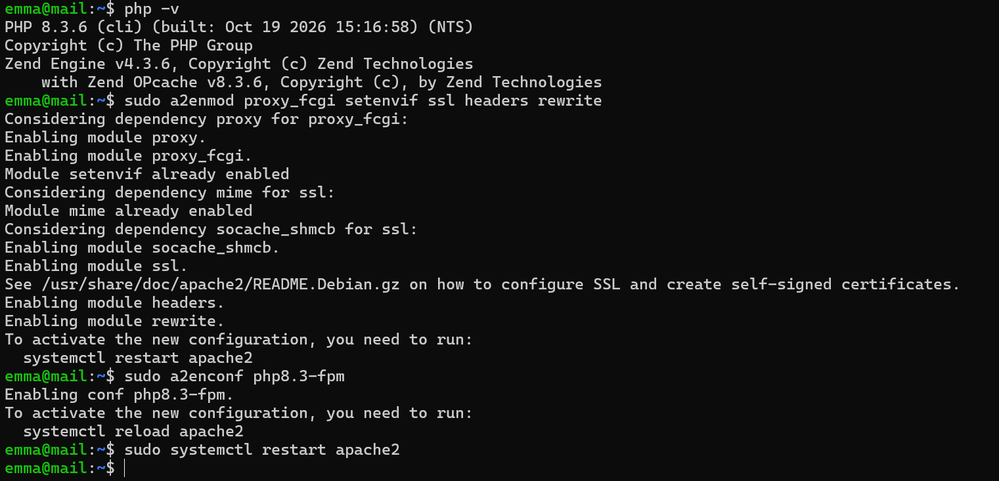
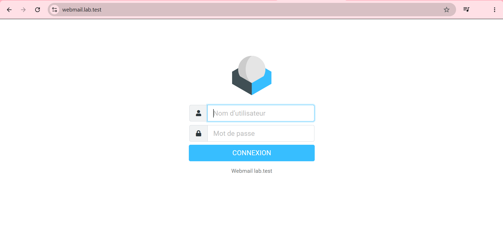
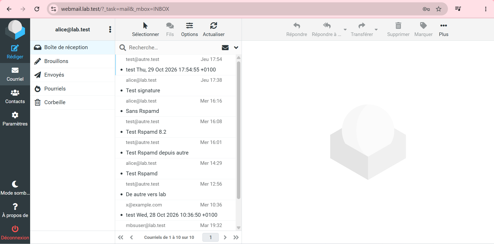
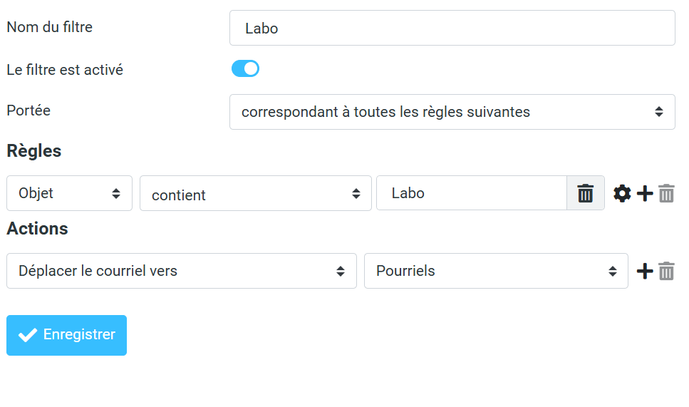
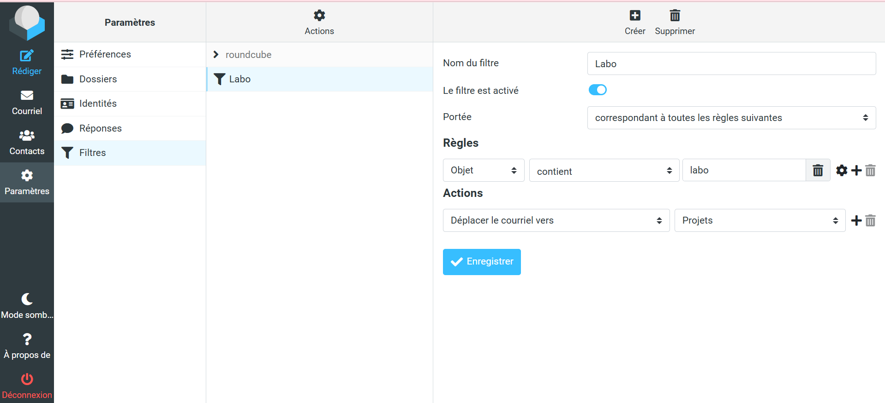
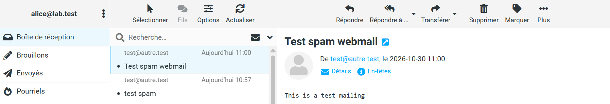
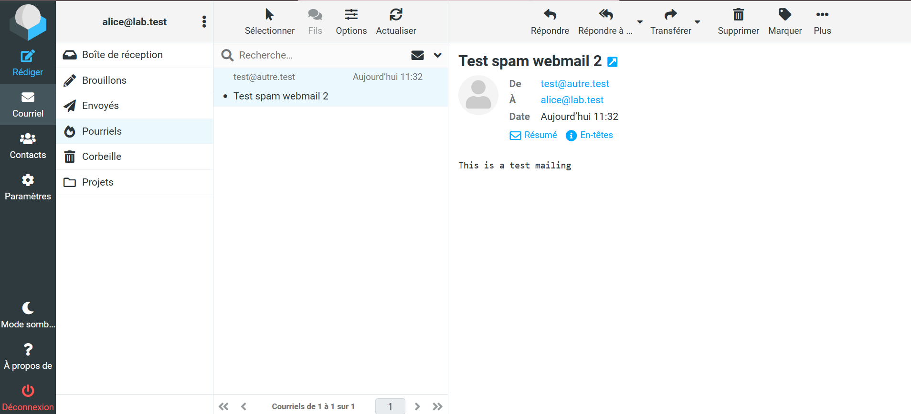

# Étape 12 — Webmail Roundcube en HTTPS

**Objectif** : `https://webmail.lab.test` sans avertissement ; lecture, envoi, suppression, classement, filtres personnels ; spam rangé automatiquement dans *Pourriels*.
**Instantané** : `12-webmail`

## Ce qui a été fait

| Élément | Choix | Raison |
| --- | --- | --- |
| Serveur web | Apache `mpm_event` + PHP 8.3 FPM ; aucun `libapache2-mod-php` | PHP isolé dans son propre service |
| Webmail | Roundcube 1.6.6 (paquet Ubuntu), base SQLite | Mises à jour par `apt` ; aucun serveur de base de données |
| Liaisons | IMAPS `ssl://mail.lab.test:993`, SMTP `ssl://mail.lab.test:465` avec les identifiants de l'utilisateur | Mêmes exigences que Thunderbird |
| Sécurité Roundcube | `force_https`, `ip_check`, `log_logins` | Session liée à l'IP, connexions journalisées |
| Site Apache | Port 80 → redirection 301 ; 443 avec TLS 1.2/1.3, en-têtes de sécurité, `DocumentRoot` limité à `public_html` | ES2 |
| Sieve | `dovecot-sieve` à la livraison LMTP, ManageSieve sur `127.0.0.1:4190` | Filtres personnels depuis Roundcube |
| Règle commune | `sieve_before` : `X-Spam-Status: Yes` → `Junk` | Le spam marqué par Rspamd est rangé automatiquement |
| Fail2ban | Prison `roundcube-auth` sur `/var/log/roundcube/errors.log` | |

Configuration : [`configs/mail/apache/`](../configs/mail/), [`configs/mail/roundcube/`](../configs/mail/), [`configs/mail/dovecot/sieve/`](../configs/mail/).

## Vérifications

Voir [`tests/etape-12.md`](../tests/etape-12.md).

## Problèmes rencontrés et solutions

| Problème | Cause | Solution | À retenir |
| --- | --- | --- | --- |
| `/var/log/roundcube/` vide | Roundcube ne crée son journal qu'au premier message à écrire ; Fail2ban refuse de démarrer si le fichier d'une prison manque | Fichier créé à l'avance (`www-data:adm 640`) | Anticiper les dépendances entre services au démarrage |
| Filtre personnel dirigé vers *Pourriels* | Mélange avec la règle anti-spam commune, rendant le test ambigu | Dossier `Projets` créé et choisi comme destination | Un test doit isoler un seul mécanisme |
| Message de test arrivé en boîte de réception au lieu de *Pourriels* | Seuil abaissé à 1, mais depuis l'étape 10 le score d'un message de `autre` est **−0,30** (`R_SPF_ALLOW`, `DMARC_POLICY_ALLOW`) | Seuil temporaire à −5, puis retour à la normale | SPF et DMARC valides font baisser le score : l'authentification inspire confiance |
| `grep 'Test spam webmail' rspamd.log` vide | Le journal de Rspamd n'enregistre pas les sujets | Lecture des lignes `rspamd_task_write_log` (action entre parenthèses) | Savoir ce qu'un journal contient avant d'y chercher |

## Ce que j'ai appris

- Un webmail n'est qu'un client IMAP/SMTP de plus, hébergé sur le serveur.
- Apache sert, PHP-FPM exécute : deux services, deux redémarrages indépendants.
- `sieve_before` impose une règle que l'utilisateur ne peut pas contourner.

## Captures

*PHP 8.3 et modules Apache*

*Page de connexion en HTTPS, sans avertissement*

*Boîte de réception d'alice*

*Premier filtre dirigé vers Pourriels (corrigé)*

*Filtre Labo vers Projets*

![Message [labo] rangé dans Projets](img/etape-12-filtre-resultat.png)
*Message [labo] rangé dans Projets*

*Problème : spam resté en boîte de réception*

*Après correction : spam dans Pourriels*
