# Preuves — Étape 2 : Machine virtuelle, réseau et accès

Date des tests : 27/10/2026 (compléments le 30/10/2026) · Instantané : `02-base`

| # | Contrôle | Commande | Attendu | Obtenu |
| --- | --- | --- | --- | --- |
| 1 | Version du système | `lsb_release -d` | Ubuntu 24.04.5 LTS | ✅ [capture](../docs/img/etape-02-console-lsb-ip.png) |
| 2 | Adresses | `ip -br a` | enp0s3 en 10.0.2.x, enp0s8 en 192.168.56.10/24 | ✅ [capture](../docs/img/etape-02-netplan-corrige.png) [capture](../docs/img/etape-02-ssh-cle.png) |
| 3 | Accès Internet | `ping -c 2 ubuntu.com` | Réponses reçues | ⬜ |
| 4 | Nom complet | `hostname -f` | mail.lab.test | ✅ [capture](../docs/img/etape-02-hostname.png) |
| 5 | Joignable depuis l'hôte | `PS> ping 192.168.56.10` | Réponses reçues | ✅ [capture](../docs/img/etape-02-ssh-cle.png) — joignable : connexion SSH réussie |
| 6 | SSH par clé | `PS> ssh emma@192.168.56.10` | Connexion par clé | ✅ [capture](../docs/img/etape-02-ssh-cle.png) |
| 7 | Mot de passe refusé | `PS> ssh -o PubkeyAuthentication=no emma@192.168.56.10` | Permission denied (publickey) | ✅ [capture](../docs/img/etape-02-ssh-mot-de-passe-refuse.png) |
| 8 | Horloge | `timedatectl` | System clock synchronized: yes | ✅ [capture](../docs/img/etape-02-timedatectl.png) |
| 9 | Journalisation | `systemctl is-active rsyslog` | active | ⬜ |
| 10 | Pare-feu | `sudo ufw status verbose` | Actif, une seule règle SSH sur enp0s8 | ✅ [capture](../docs/img/etape-03-ufw-dns.png) — relevé à l'étape 3, avec les règles DNS en plus |

✅ vérifié, avec capture · ➖ écart expliqué · ⬜ pas de capture conservée.

## Captures

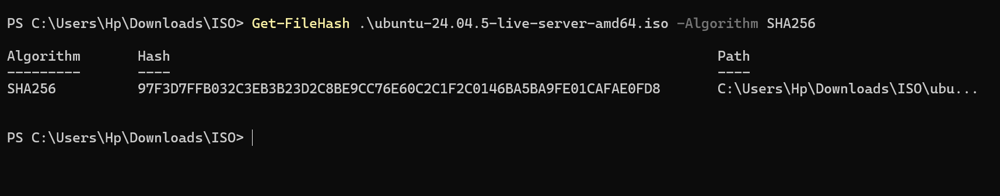
*Empreinte SHA256 de l'ISO vérifiée*

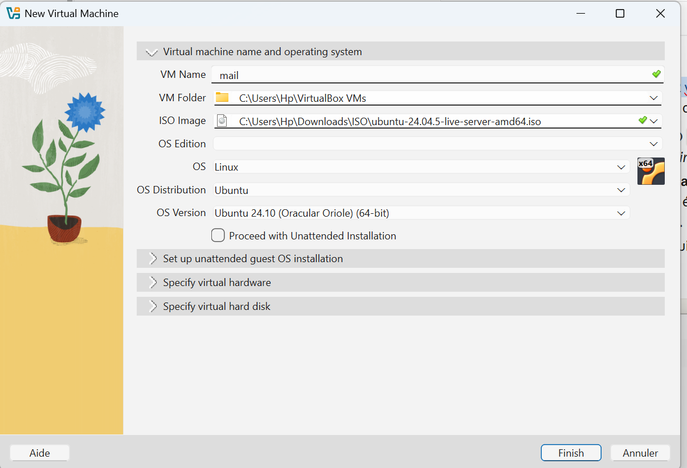
*Création de la VM mail*

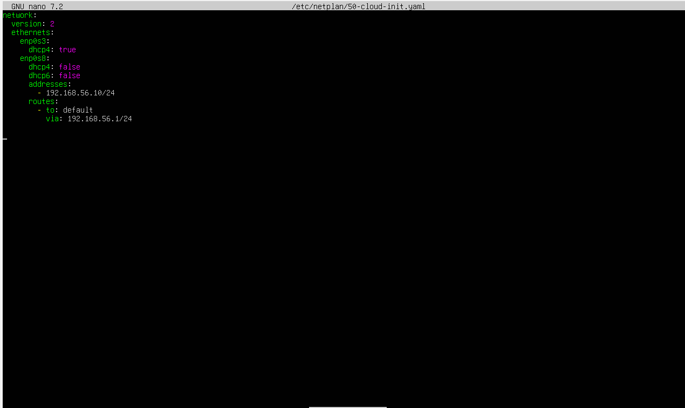
*Problème : route par défaut ajoutée à tort sur enp0s8*

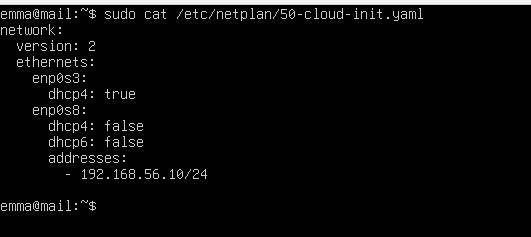
*Netplan corrigé : NAT en DHCP, réseau privé en adresse fixe*

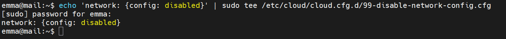
*cloud-init ne réécrit plus la configuration réseau*

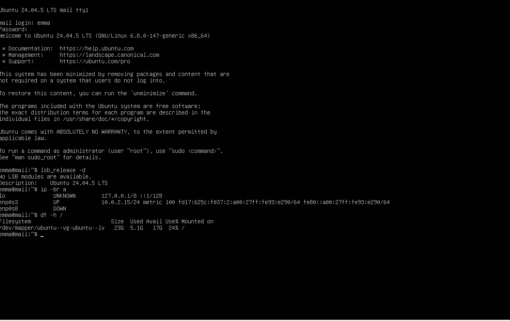
*Version du système, adresses, disque*

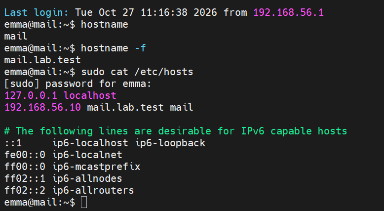
*Nom complet mail.lab.test*

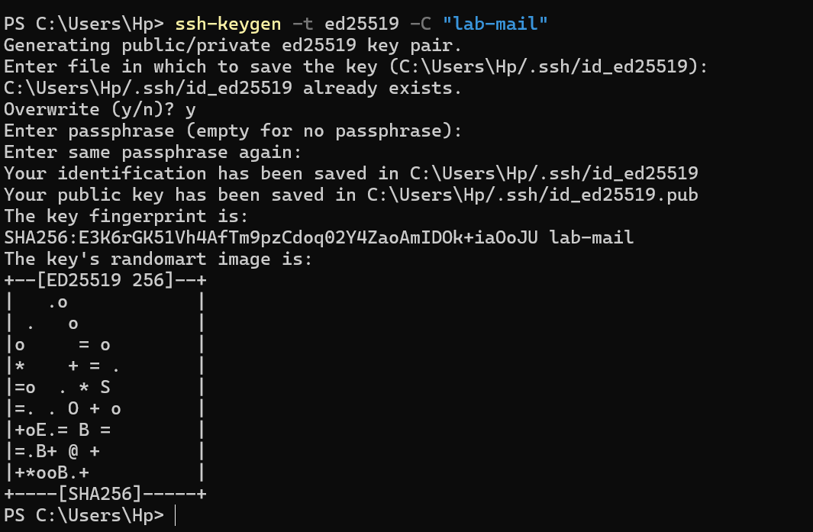
*Génération de la clé ed25519 sur Windows*

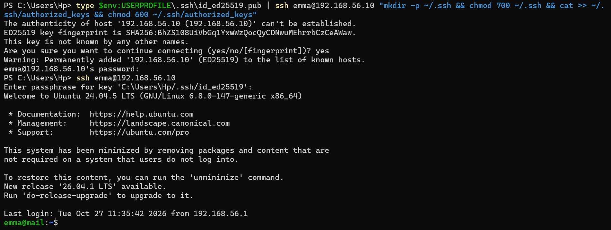
*Dépôt de la clé publique puis connexion par clé*

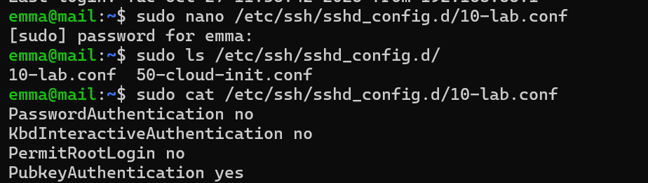
*SSH : mot de passe et root interdits*

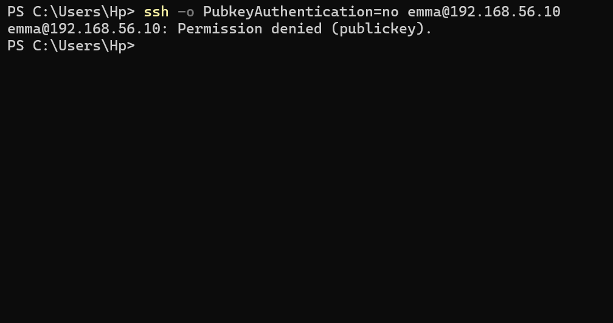
*Connexion par mot de passe refusée*

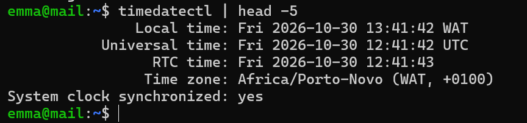
*Horloge synchronisée, fuseau Africa/Porto-Novo*
