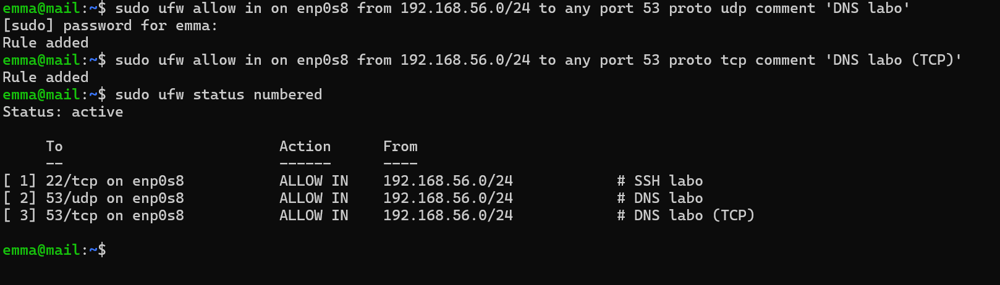
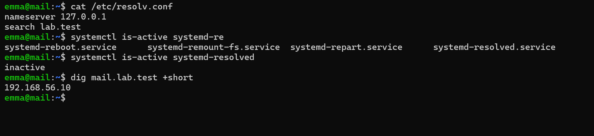
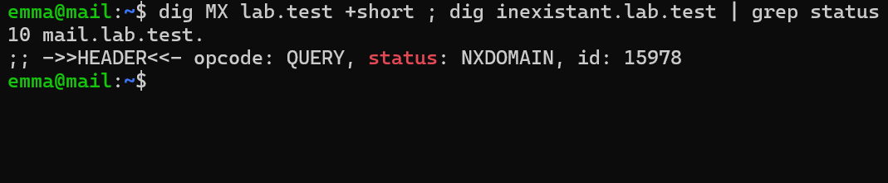
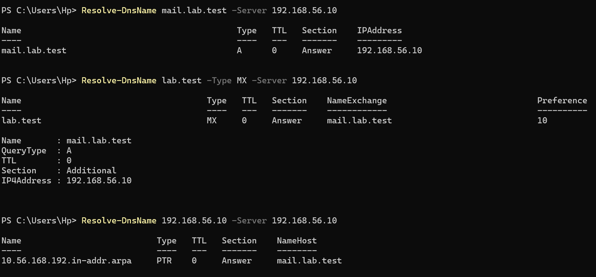

# Preuves — Étape 3 : DNS local avec dnsmasq

Date des tests : 27/10/2026 (compléments le 30/10/2026) · Instantané : `03-dns`

| # | Contrôle | Commande | Attendu | Obtenu |
| --- | --- | --- | --- | --- |
| 1 | Service | `systemctl is-active dnsmasq` | active | ⬜ |
| 2 | Écoute | `sudo ss -lunp 'sport = :53'` | 127.0.0.1 et 192.168.56.10 uniquement | ⬜ |
| 3 | Enregistrement A | `dig mail.lab.test +short` | 192.168.56.10 | ✅ [capture](../docs/img/etape-03-resolv-dig.png) |
| 4 | MX lab.test | `dig MX lab.test +short` | 10 mail.lab.test. | ✅ [capture](../docs/img/etape-03-dig-mx-nxdomain.png) |
| 5 | MX autre.test | `dig MX autre.test +short` | 10 mail.autre.test. | ⬜ |
| 6 | PTR | `dig -x 192.168.56.10 +short` | mail.lab.test. | ✅ [capture](../docs/img/etape-03-resolve-dnsname.png) — PTR vérifié depuis Windows |
| 7 | Zone fermée | `dig inexistant.lab.test` | status: NXDOMAIN | ✅ [capture](../docs/img/etape-03-dig-mx-nxdomain.png) |
| 8 | Internet | `dig ubuntu.com +short ; sudo apt update` | Adresses publiques | ⬜ |
| 9 | Résolveur système | `cat /etc/resolv.conf` | nameserver 127.0.0.1 | ✅ [capture](../docs/img/etape-03-resolv-dig.png) |
| 10 | Depuis l'hôte | `PS> Resolve-DnsName lab.test -Type MX -Server 192.168.56.10` | mail.lab.test, préférence 10 | ✅ [capture](../docs/img/etape-03-resolve-dnsname.png) |

✅ vérifié, avec capture · ➖ écart expliqué · ⬜ pas de capture conservée.

## Captures

*Pare-feu : SSH et DNS ouverts sur le réseau du labo uniquement*

*Résolveur local, systemd-resolved désactivé, enregistrement A*

*MX de lab.test et zone fermée (NXDOMAIN)*

*Résolution A, MX et PTR depuis Windows*
