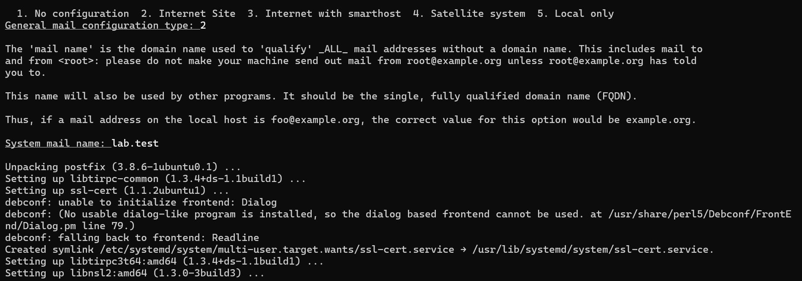
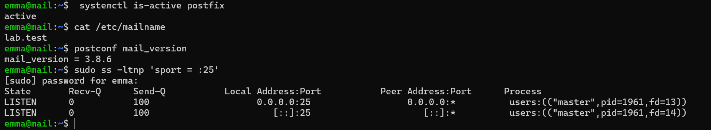
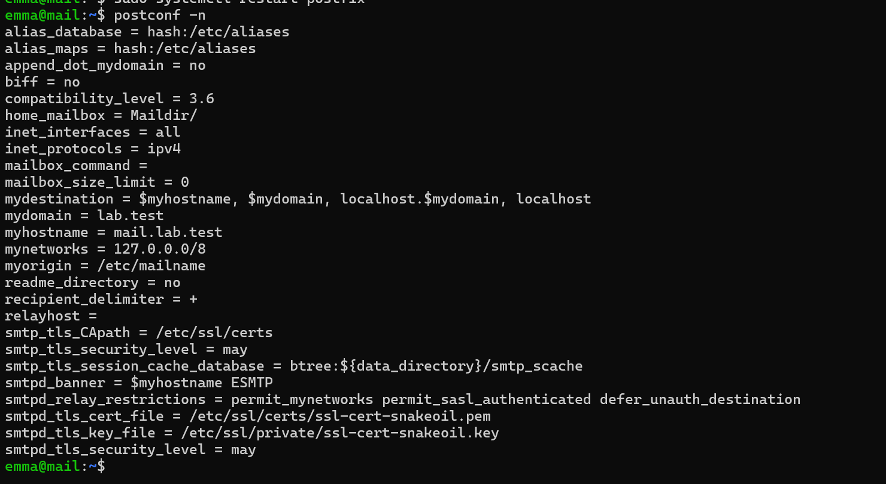
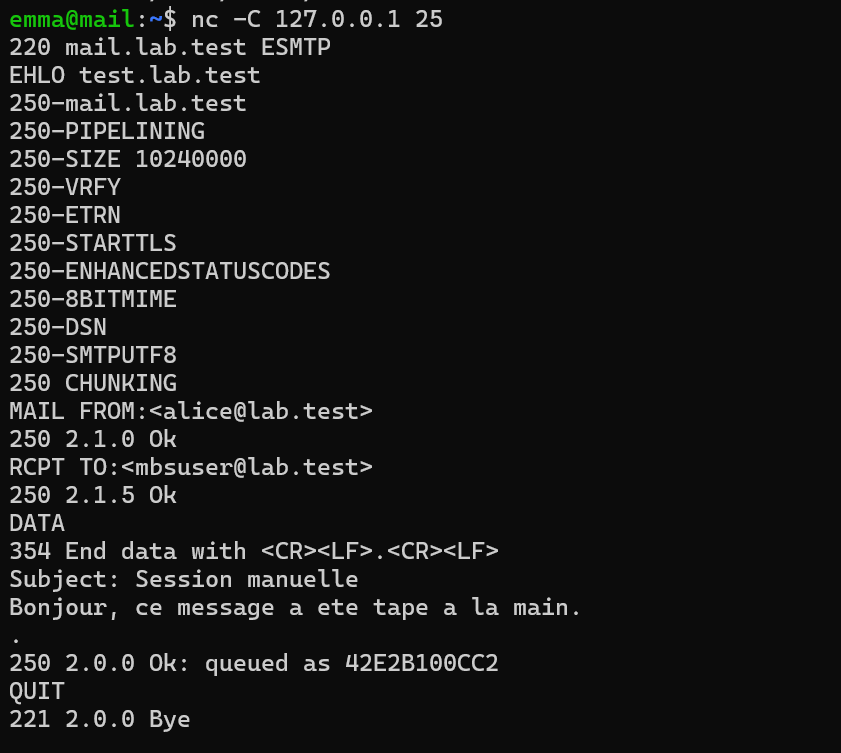
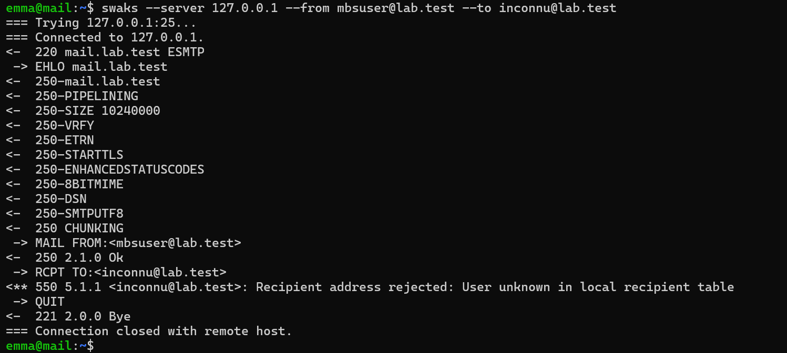
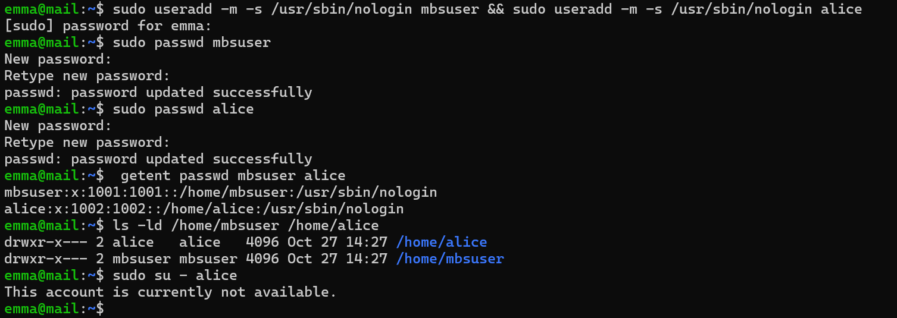
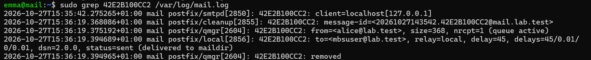
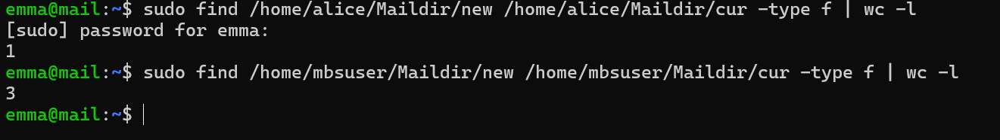
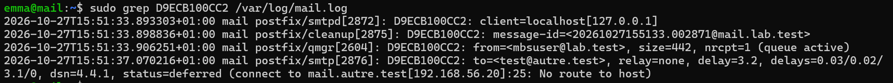
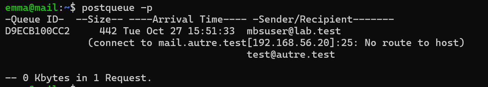

# Preuves — Étape 4 : Postfix en livraison locale

Date des tests : 27/10/2026 (compléments le 30/10/2026) · Instantané : `04-postfix`

| # | Contrôle | Commande | Attendu | Obtenu |
| --- | --- | --- | --- | --- |
| 1 | Service | `systemctl is-active postfix` | active | ✅ [capture](../docs/img/etape-04-postfix-actif.png) |
| 2 | Configuration | `sudo postfix check` | Aucune sortie | ⬜ |
| 3 | Identité | `postconf myhostname mydestination` | mail.lab.test ; lab.test dans mydestination | ✅ [capture](../docs/img/etape-04-postconf-n.png) |
| 4 | Relais restreint | `postconf mynetworks` | 127.0.0.0/8 | ✅ [capture](../docs/img/etape-04-postconf-n.png) |
| 5 | Livraison alice | `swaks --server 127.0.0.1 --to alice@lab.test` | Fichier dans ~/Maildir/new/ | ✅ [capture](../docs/img/etape-04-livraison-maildir.png) [capture](../docs/img/etape-04-messages-maildir.png) |
| 6 | Alias root | `swaks … --to root@lab.test` | Message chez emma | ⬜ |
| 7 | Permissions | `sudo stat -c '%a %U' /home/alice/Maildir` | 700 alice | ✅ [capture](../docs/img/etape-05-maildir-alice.png) — drwx------ alice |
| 8 | Destinataire inconnu | `swaks … --to inconnu@lab.test` | 550 5.1.1 User unknown | ✅ [capture](../docs/img/etape-04-destinataire-inconnu.png) |
| 9 | File propre | `postqueue -p` | Mail queue is empty | ➖ [capture](../docs/img/etape-04-postqueue.png) — un message vers autre.test en attente : normal tant que autre n'existe pas (étape 8) |

✅ vérifié, avec capture · ➖ écart expliqué · ⬜ pas de capture conservée.

## Captures

*Installation de Postfix*

*Postfix actif, version 3.8.6, à l'écoute sur 25*

*Configuration effective de Postfix*

*Session SMTP tapée à la main*

*Destinataire inconnu refusé (550 5.1.1)*

*Comptes système de test (supprimés à l'étape 6)*

*Livraison locale dans le Maildir*

*Messages présents dans les Maildir*

*Message vers autre.test en attente : No route to host*

*File d'attente avec le message différé*
