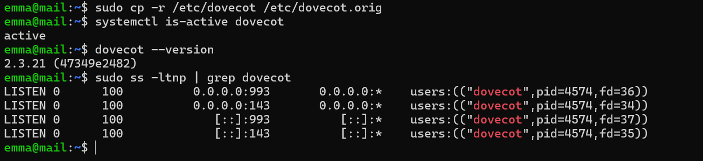
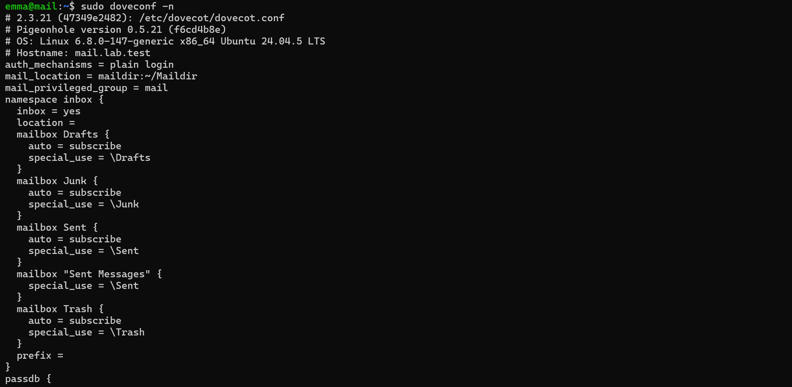
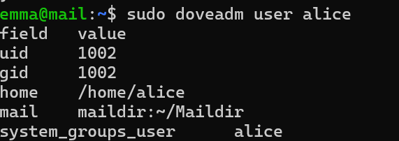
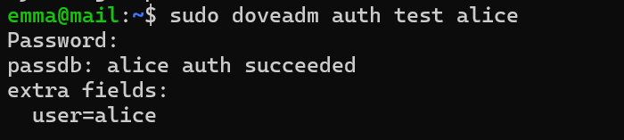
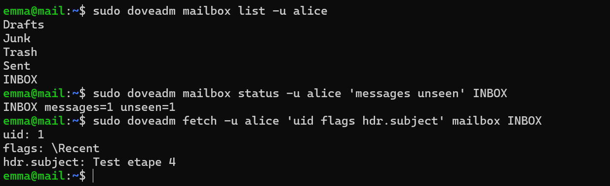
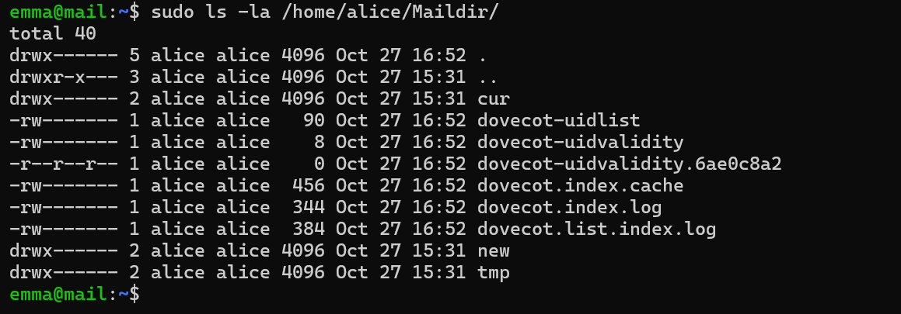
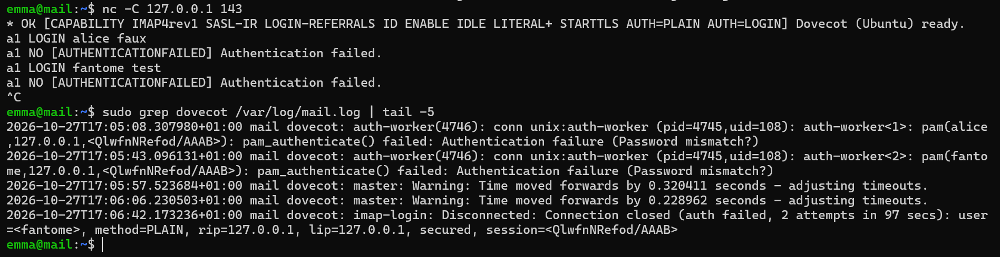
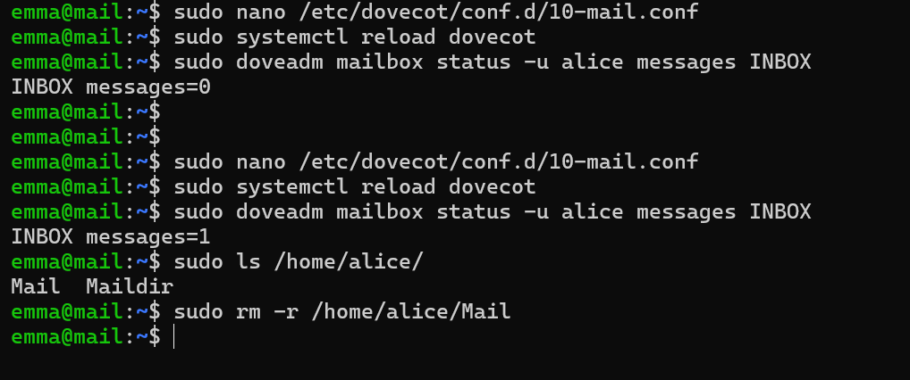

# Preuves — Étape 5 : Dovecot et IMAP

Date des tests : 27/10/2026 (compléments le 30/10/2026) · Instantané : `05-dovecot`

| # | Contrôle | Commande | Attendu | Obtenu |
| --- | --- | --- | --- | --- |
| 1 | Service | `systemctl is-active dovecot` | active | ✅ [capture](../docs/img/etape-05-dovecot-actif.png) |
| 2 | Emplacement | `sudo doveconf -n \| grep mail_location` | maildir:~/Maildir | ✅ [capture](../docs/img/etape-05-doveconf-n.png) |
| 3 | Utilisateur connu | `sudo doveadm user alice` | home=/home/alice | ✅ [capture](../docs/img/etape-05-doveadm-user.png) |
| 4 | Mot de passe | `sudo doveadm auth test alice` | auth succeeded | ✅ [capture](../docs/img/etape-05-auth-test.png) |
| 5 | Dossiers spéciaux | `sudo doveadm mailbox list -u alice` | INBOX, Drafts, Junk, Trash, Sent | ✅ [capture](../docs/img/etape-05-mailbox.png) |
| 6 | Session IMAP | `nc -C 127.0.0.1 143 : LOGIN, SELECT INBOX` | OK Logged in, EXISTS | ⬜ — lecture vérifiée par doveadm fetch, puis par Thunderbird à l'étape 7 |
| 7 | Drapeaux | `ls /home/alice/Maildir/cur/` | Suffixe :2,S | ⬜ |
| 8 | Mauvais mot de passe | `LOGIN alice faux` | NO [AUTHENTICATIONFAILED] | ✅ [capture](../docs/img/etape-05-imap-echecs.png) |

✅ vérifié, avec capture · ➖ écart expliqué · ⬜ pas de capture conservée.

## Captures

*Dovecot 2.3.21 actif, ports 143 et 993*

*Configuration effective de Dovecot*

*Utilisateur système alice vu par Dovecot*

*Authentification réussie*

*Dossiers spéciaux et message lu par doveadm*

*Maildir d'alice : dossiers 700, fichiers 600*

*Échecs IMAP volontaires et journal correspondant*

*Problème : mauvais mail_location, INBOX vide*
