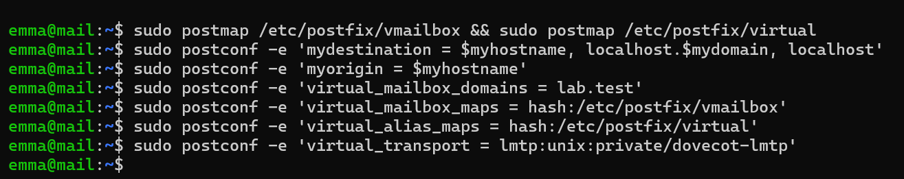
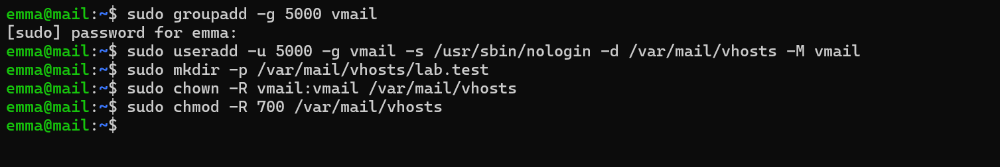
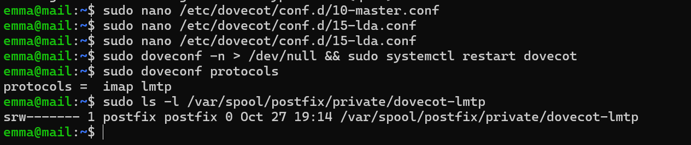
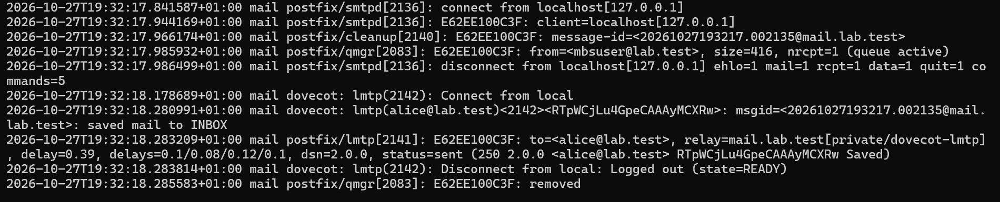
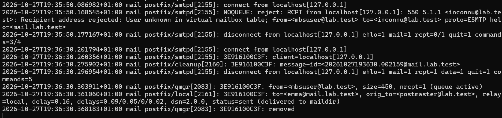
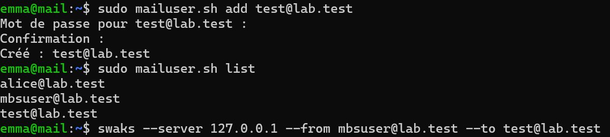
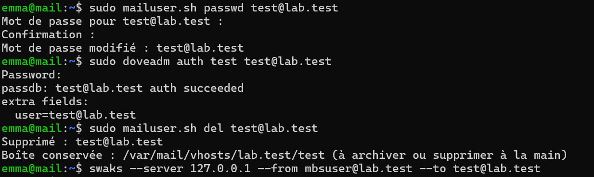
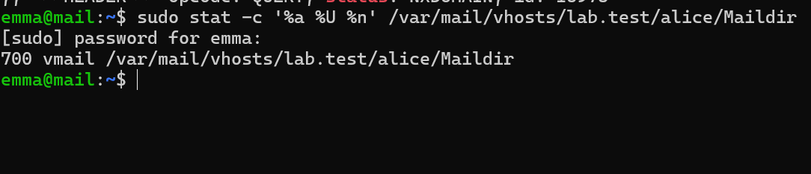
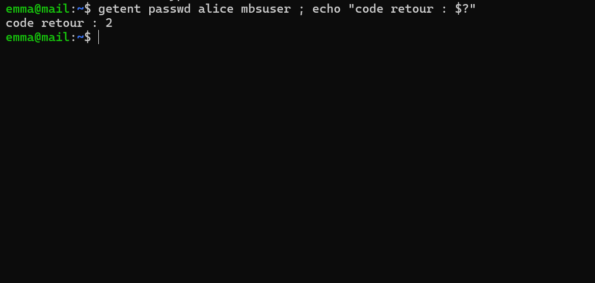

# Preuves — Étape 6 : Utilisateurs virtuels et LMTP

Date des tests : 27/10/2026 (compléments le 30/10/2026) · Instantané : `06-virtuels`

| # | Contrôle | Commande | Attendu | Obtenu |
| --- | --- | --- | --- | --- |
| 1 | Domaine virtuel | `postconf mydestination virtual_mailbox_domains` | lab.test uniquement dans virtual_mailbox_domains | ✅ [capture](../docs/img/etape-06-postconf-virtual.png) |
| 2 | Utilisateur Dovecot | `sudo doveadm user alice@lab.test` | uid=5000, home=/var/mail/vhosts/lab.test/alice | ⬜ |
| 3 | Authentification | `sudo doveadm auth test alice@lab.test` | auth succeeded | ✅ [capture](../docs/img/etape-06-mailuser-passwd-del.png) |
| 4 | Livraison LMTP | `swaks … --to alice@lab.test ; mail.log` | postfix/lmtp … status=sent … Saved | ✅ [capture](../docs/img/etape-06-livraison-lmtp.png) |
| 5 | Échange mbsuser ↔ alice | `swaks dans les deux sens` | Messages livrés | ✅ [capture](../docs/img/etape-12-boite-reception.png) — messages de mbsuser dans la boîte d'alice |
| 6 | Propriétaire et droits | `sudo stat -c '%a %U' …/alice/Maildir ; fichiers` | 700 vmail ; fichiers 600 | ✅ [capture](../docs/img/etape-06-stat-maildir.png) [capture](../docs/img/etape-05-maildir-alice.png) |
| 7 | Destinataire inconnu | `swaks … --to inconnu@lab.test` | 550 5.1.1 … virtual mailbox table | ✅ [capture](../docs/img/etape-06-inconnu-et-alias.png) |
| 8 | Alias | `swaks … --to postmaster@lab.test` | Livré chez emma | ✅ [capture](../docs/img/etape-06-inconnu-et-alias.png) — orig_to=postmaster, livré chez emma |
| 9 | Script | `sudo mailuser.sh add / passwd / del test@lab.test` | Chaque action vérifiée | ✅ [capture](../docs/img/etape-06-mailuser-add.png) [capture](../docs/img/etape-06-mailuser-passwd-del.png) |
| 10 | Plus de comptes système | `getent passwd alice mbsuser` | Aucune sortie | ✅ [capture](../docs/img/etape-06-getent.png) — aucune sortie, code retour 2 |

✅ vérifié, avec capture · ➖ écart expliqué · ⬜ pas de capture conservée.

## Captures

*Domaine virtuel et transport LMTP*

*Utilisateur vmail (UID/GID 5000)*

*Socket LMTP de Dovecot dans la prison Postfix*

*Livraison LMTP : saved mail to INBOX*

*Destinataire inconnu (550) et alias postmaster*

*mailuser.sh : création et liste*

*mailuser.sh : mot de passe, test, suppression*

*Maildir virtuel : 700 vmail*

*Plus aucun compte système pour les boîtes*
