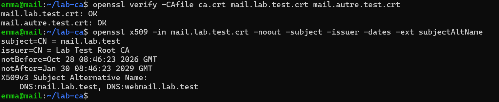
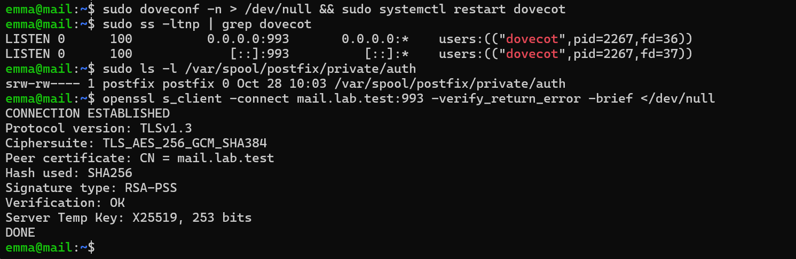
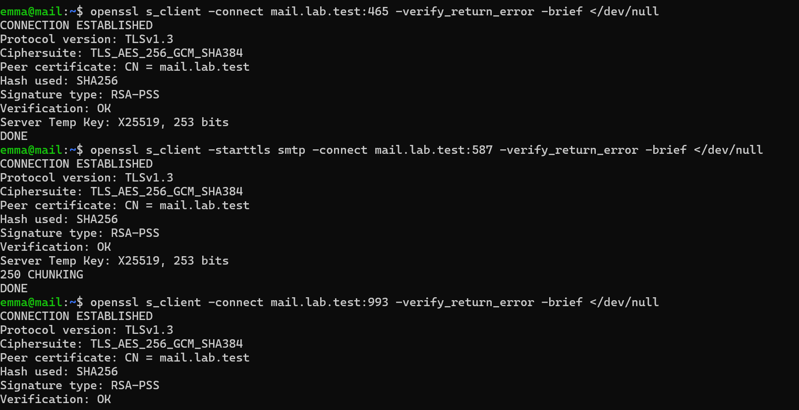
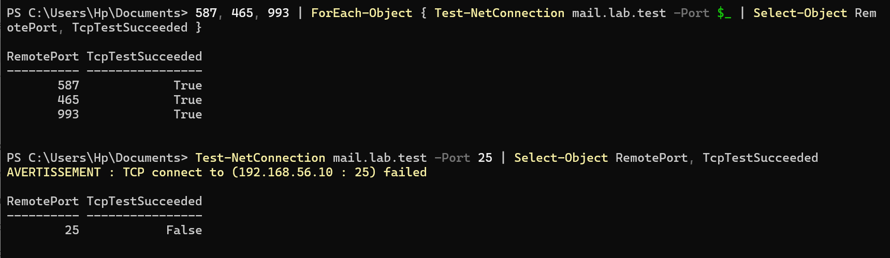
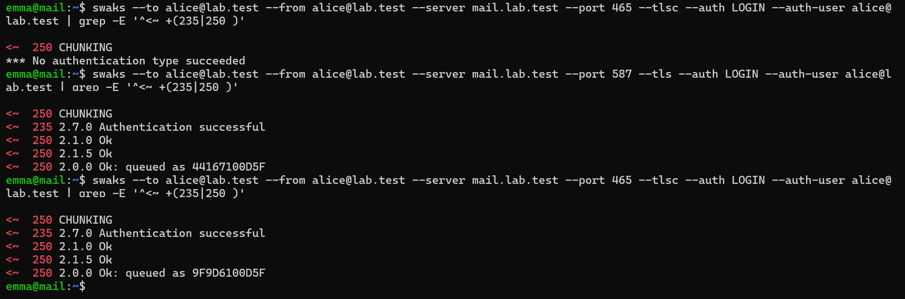
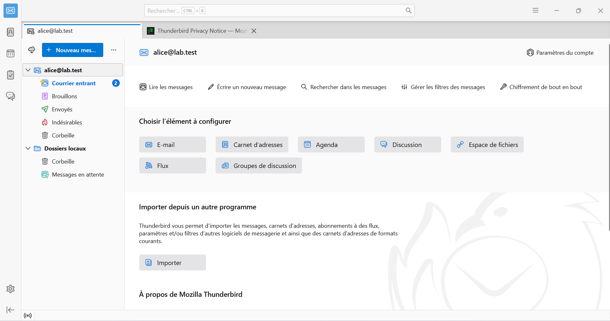

# Preuves — Étape 7 : CA locale, TLS et authentification SMTP

Date des tests : 28/10/2026 (compléments le 30/10/2026) · Instantané : `07-tls-sasl`

| # | Contrôle | Commande | Attendu | Obtenu |
| --- | --- | --- | --- | --- |
| 1 | Chaîne de confiance | `openssl verify -CAfile … mail.lab.test.fullchain.pem` | OK | ✅ [capture](../docs/img/etape-07-openssl-verify.png) |
| 2 | Clé de la CA hors de la VM | `ls ~/lab-ca` | Aucun fichier .key | ⬜ |
| 3 | Ports à l'écoute | `sudo ss -ltn` | 25, 465, 587, 993 ; plus de 143 | ✅ [capture](../docs/img/etape-07-dovecot-993.png) |
| 4 | IMAPS vérifié | `openssl s_client -connect mail.lab.test:993 -verify_return_error -brief` | Verification: OK | ✅ [capture](../docs/img/etape-07-s-client.png) [capture](../docs/img/etape-07-dovecot-993.png) |
| 5 | Envoi sur 587 | `swaks --port 587 --tls --auth` | 235 puis 250 queued | ✅ [capture](../docs/img/etape-07-envoi-authentifie.png) |
| 6 | Envoi sur 465 | `swaks --port 465 --tlsc --auth` | 235 puis 250 queued | ✅ [capture](../docs/img/etape-07-envoi-authentifie.png) |
| 7 | Non-relais | `swaks --server 192.168.56.10 --to y@example.com` | 554 5.7.1 Relay access denied | ✅ [capture](../docs/img/etape-08-relay-denied.png) — relevé depuis autre |
| 8 | Pas d'envoi anonyme | `swaks --port 587 --tls sans --auth` | 554 5.7.1 Access denied | ⬜ |
| 9 | Pare-feu | `PS> Test-NetConnection mail.lab.test -Port 587,465,993 / 25` | True / False | ✅ [capture](../docs/img/etape-07-test-netconnection.png) |
| 10 | Client graphique | `Thunderbird` | Réception et envoi sans avertissement | ✅ [capture](../docs/img/etape-07-thunderbird.png) |

✅ vérifié, avec capture · ➖ écart expliqué · ⬜ pas de capture conservée.

## Captures

*Certificats vérifiés par la CA, SAN mail et webmail*

*IMAP 143 fermé, socket SASL, IMAPS vérifié*

*TLS 1.3 vérifié sur 465, 587 et 993*

*Ports clients ouverts, 25 fermé depuis Windows*

*Envoi authentifié sur 587 et 465 (saisie masquée)*

*Compte alice@lab.test dans Thunderbird*
