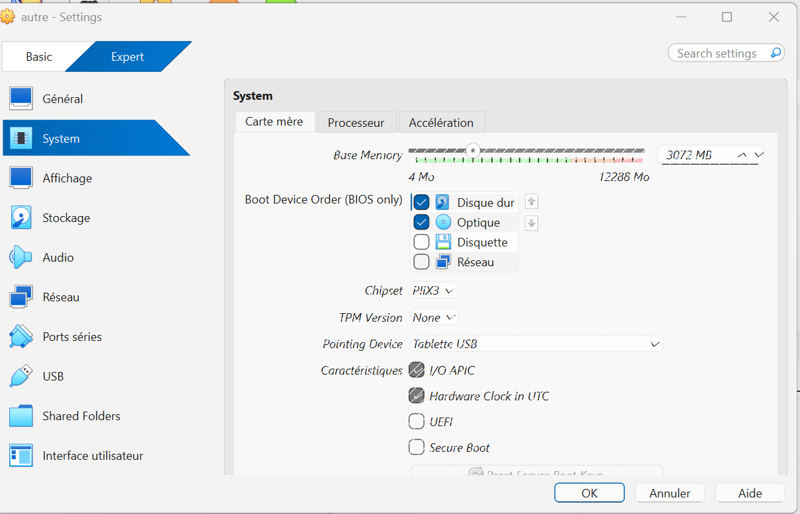
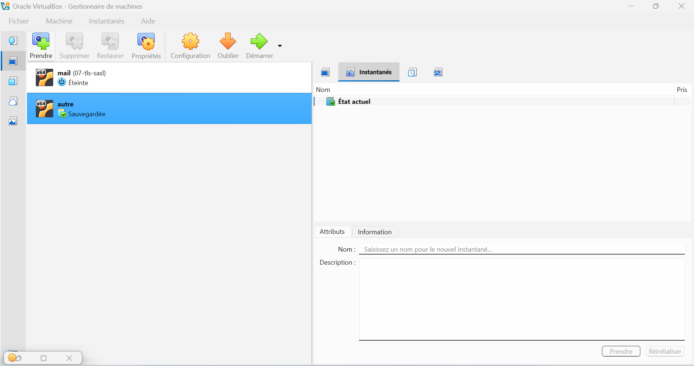
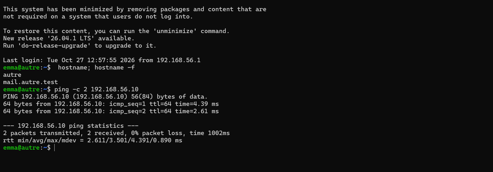
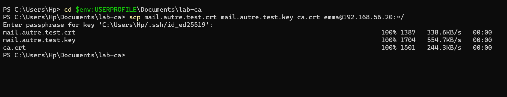
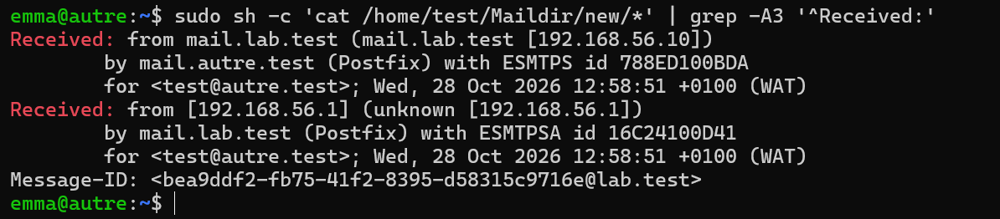
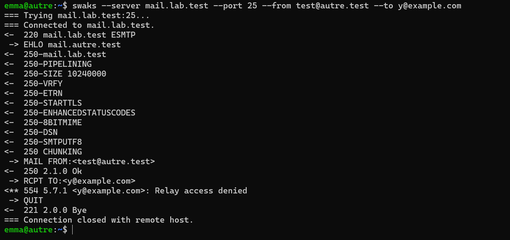

# Preuves — Étape 8 : Second domaine et échanges entre serveurs

Date des tests : 28/10/2026 (compléments le 30/10/2026) · Instantané : `08-deux-domaines`

| # | Contrôle | Commande | Attendu | Obtenu |
| --- | --- | --- | --- | --- |
| 1 | Identité du clone | `autre : hostname -f ; ip -br a` | mail.autre.test ; 192.168.56.20/24 | ✅ [capture](../docs/img/etape-08-identite-autre.png) |
| 2 | Clés SSH distinctes | `ssh-keygen -lf /etc/ssh/ssh_host_ed25519_key.pub sur chaque VM` | Empreintes différentes | ⬜ |
| 3 | DNS distant | `autre : dig MX lab.test +short` | 10 mail.lab.test. | ⬜ |
| 4 | Port 25 croisé | `nc -vz depuis chaque VM` | succeeded | ⬜ |
| 5 | autre → lab.test | `journal d'autre` | relay=mail.lab.test[…]:25 status=sent | ✅ [capture](../docs/img/etape-10-auth-results-mail.png) — message de autre reçu par mail |
| 6 | lab.test → autre | `sudo ls /home/test/Maildir/new/` | Message présent | ✅ [capture](../docs/img/etape-08-received.png) |
| 7 | Chiffrement | `journaux des deux VM` | TLS connection established | ✅ [capture](../docs/img/etape-08-received.png) — ESMTPS / ESMTPSA = TLS |
| 8 | Trajet complet | `en-têtes Received:` | ESMTPSA puis ESMTPS | ✅ [capture](../docs/img/etape-08-received.png) |
| 9 | Non-relais | `autre : swaks --server mail.lab.test --to y@example.com` | 554 5.7.1 Relay access denied | ✅ [capture](../docs/img/etape-08-relay-denied.png) |
| 10 | Reprise après panne | `postfix arrêté sur autre, puis postqueue -f` | Message livré | ⬜ |

✅ vérifié, avec capture · ➖ écart expliqué · ⬜ pas de capture conservée.

## Captures

*Problème : réglages du clone grisés*

*Cause : clone dans l'état « Sauvegardée »*

*Identité du clone et accès à mail*

*Copie du certificat de autre depuis Windows*

*Trajet : ESMTPSA puis ESMTPS*

*Relais refusé depuis autre (554 5.7.1)*
