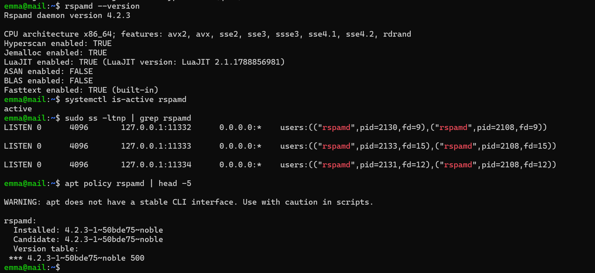
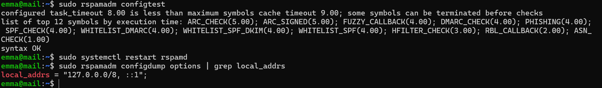
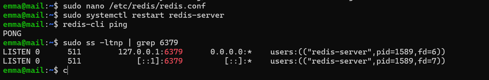
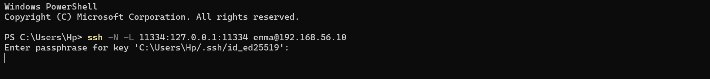
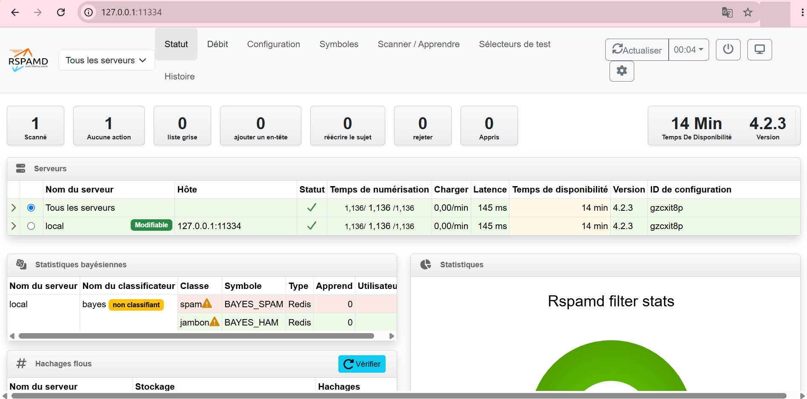
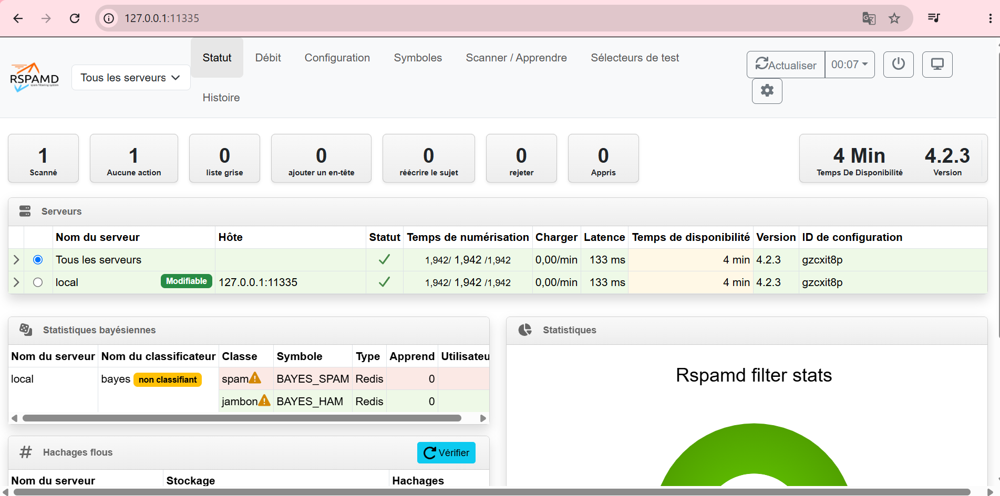
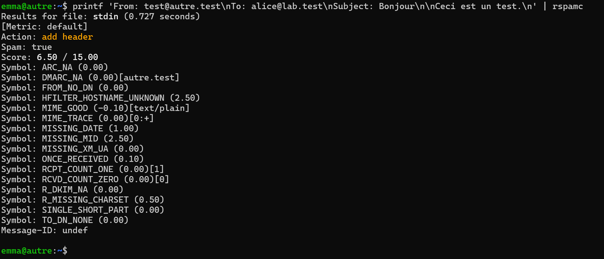
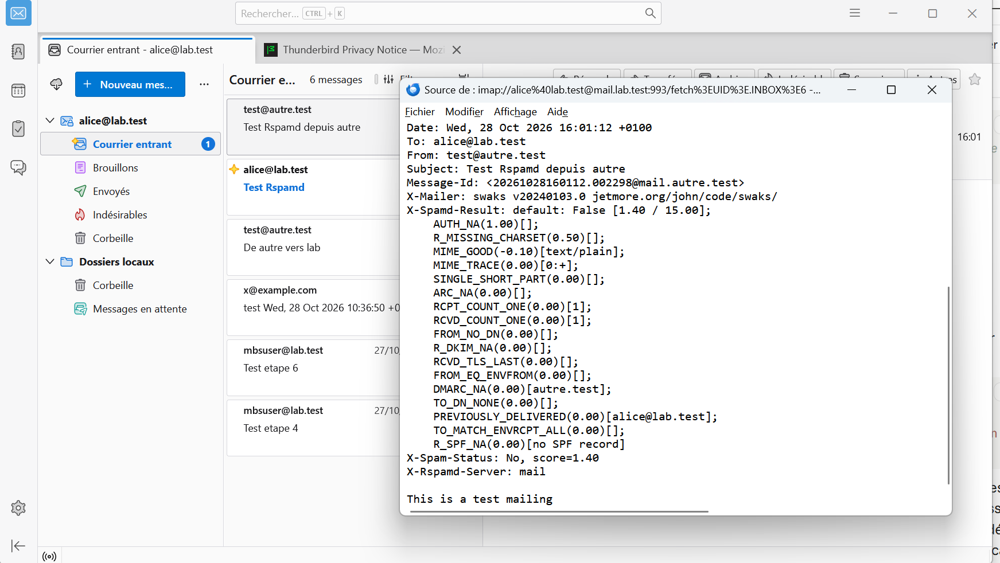
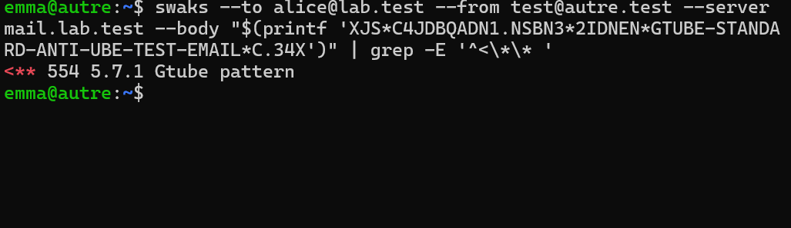

# Preuves — Étape 9 : Rspamd et Redis

Date des tests : 28/10/2026 (compléments le 30/10/2026) · Instantané : `09-rspamd`

| # | Contrôle | Commande | Attendu | Obtenu |
| --- | --- | --- | --- | --- |
| 1 | Services | `systemctl is-active rspamd redis-server` | active ×2, sur les deux VM | ✅ [capture](../docs/img/etape-09-rspamd-version.png) [capture](../docs/img/etape-09-redis.png) |
| 2 | Écoute locale | `sudo ss -ltnp \| grep -E '1133[234]\|6379'` | 127.0.0.1 uniquement | ✅ [capture](../docs/img/etape-09-rspamd-version.png) [capture](../docs/img/etape-09-redis.png) |
| 3 | Dépôt officiel | `apt policy rspamd` | Version de rspamd.com | ✅ [capture](../docs/img/etape-09-rspamd-version.png) |
| 4 | Configuration | `sudo rspamadm configtest` | syntax OK | ✅ [capture](../docs/img/etape-09-configtest.png) |
| 5 | Adresses locales | `sudo rspamadm configdump options \| grep local_addrs` | 127.0.0.0/8, ::1 | ✅ [capture](../docs/img/etape-09-configtest.png) |
| 6 | Milter | `postconf smtpd_milters` | inet:127.0.0.1:11332 | ⬜ |
| 7 | En-têtes | `source d'un message reçu` | X-Spamd-Result, Authentication-Results | ✅ [capture](../docs/img/etape-09-x-spamd-result.png) |
| 8 | GTUBE | `swaks depuis autre vers le port 25 de mail` | 554 5.7.1, ligne reject | ✅ [capture](../docs/img/etape-09-gtube.png) — 554 5.7.1 Gtube pattern |
| 9 | Redis | `redis-cli info keyspace` | db0:keys > 0 | ✅ [capture](../docs/img/etape-09-redis.png) — PONG ; keyspace non relevé |
| 10 | Interface | `tunnel SSH, http://127.0.0.1:11334` | Historique visible | ✅ [capture](../docs/img/etape-09-tunnel-ssh.png) [capture](../docs/img/etape-09-interface-mail.png) [capture](../docs/img/etape-09-interface-autre.png) |

✅ vérifié, avec capture · ➖ écart expliqué · ⬜ pas de capture conservée.

## Captures

*Rspamd 4.2.3 du dépôt officiel, en écoute locale*

*configtest et local_addrs*

*Redis local*

*Tunnel SSH vers l'interface*

*Interface Rspamd de mail*

*Interface Rspamd de autre*

*Analyse d'un message incomplet par rspamc*

*En-têtes ajoutés par Rspamd (avant SPF)*

*Message GTUBE rejeté*
