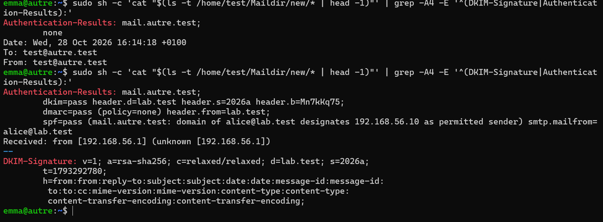
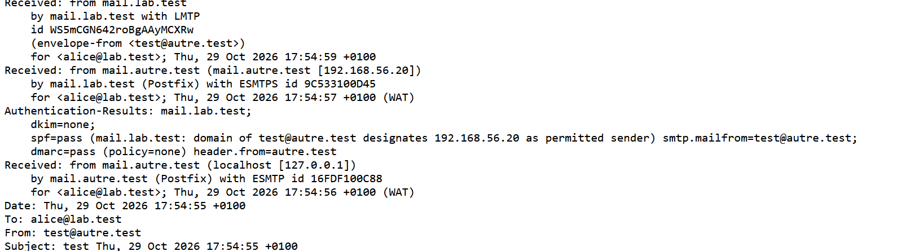
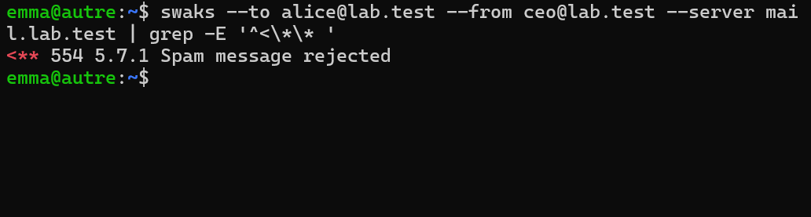

# Preuves — Étape 10 : SPF, DKIM et DMARC

Date des tests : 28-29/10/2026 (compléments le 30/10/2026) · Instantané : `10-spf-dkim-dmarc`

| # | Contrôle | Commande | Attendu | Obtenu |
| --- | --- | --- | --- | --- |
| 1 | SPF publié | `dig TXT lab.test +short` | "v=spf1 mx -all" | ⬜ |
| 2 | Clé DKIM publiée | `dig TXT 2026a._domainkey.lab.test +short` | v=DKIM1; k=rsa; p=… | ⬜ |
| 3 | DMARC publié | `dig TXT _dmarc.lab.test +short` | v=DMARC1; p=reject; … | ⬜ |
| 4 | Clé privée protégée | `sudo stat -c '%a %U' /var/lib/rspamd/dkim/lab.test.2026a.key` | 440 _rspamd | ⬜ |
| 5 | Signature | `DKIM-Signature: reçu par test` | d=lab.test; s=2026a | ✅ [capture](../docs/img/etape-10-auth-results-autre.png) |
| 6 | DKIM vérifié | `Authentication-Results sur autre` | dkim=pass | ✅ [capture](../docs/img/etape-10-auth-results-autre.png) |
| 7 | SPF vérifié | `idem` | spf=pass | ✅ [capture](../docs/img/etape-10-auth-results-autre.png) |
| 8 | DMARC vérifié | `idem` | dmarc=pass (policy=reject) | ✅ [capture](../docs/img/etape-10-auth-results-autre.png) — dmarc=pass ; capture prise pendant la phase p=none |
| 9 | Usurpation refusée | `swaks --server 192.168.56.20 --from alice@lab.test` | 554 5.7.1 | ✅ [capture](../docs/img/etape-10-usurpation-refusee.png) — variante : faux ceo@lab.test envoyé depuis autre vers mail |
| 10 | Politique appliquée | `grep DMARC_POLICY_REJECT rspamd.log (autre)` | (reject) | ⬜ |

✅ vérifié, avec capture · ➖ écart expliqué · ⬜ pas de capture conservée.

## Captures

*Vu par autre : dkim, spf et dmarc pass*

*Vu par mail : message de autre.test*

*Usurpation de lab.test refusée*
