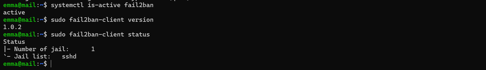
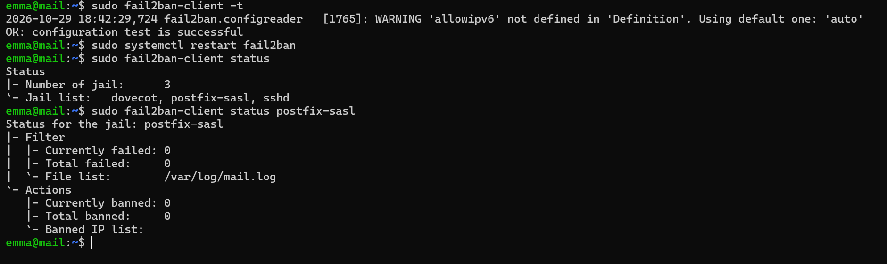
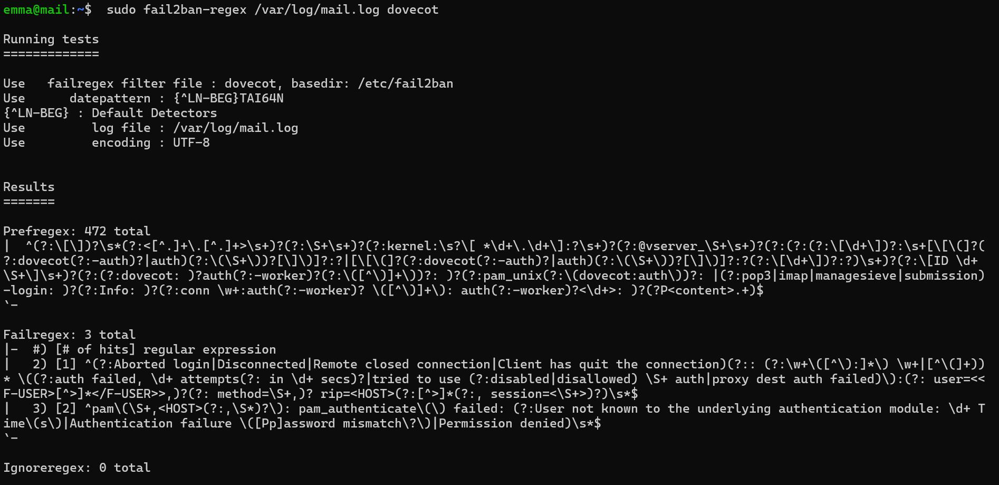
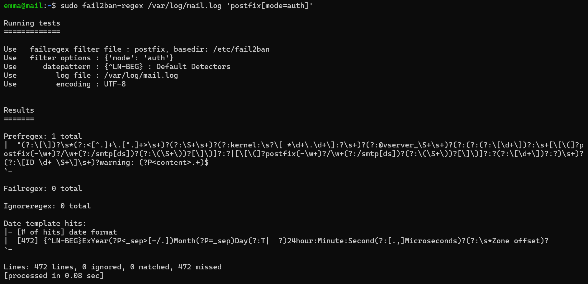
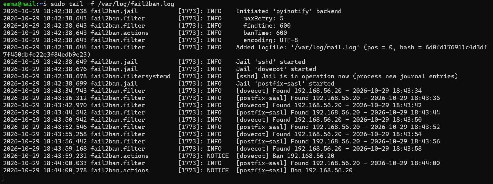
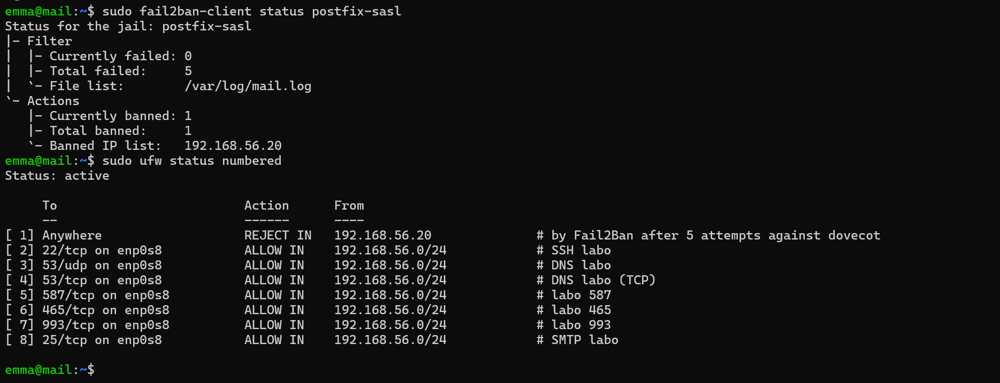
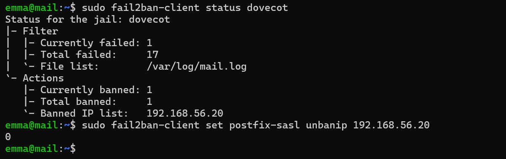

# Preuves — Étape 11 : Fail2ban

Date des tests : 29/10/2026 (compléments le 30/10/2026) · Instantané : `11-fail2ban`

| # | Contrôle | Commande | Attendu | Obtenu |
| --- | --- | --- | --- | --- |
| 1 | Service | `systemctl is-active fail2ban` | active | ✅ [capture](../docs/img/etape-11-version.png) |
| 2 | Configuration | `sudo fail2ban-client -t` | configuration test is successful | ✅ [capture](../docs/img/etape-11-prisons.png) |
| 3 | Prisons | `sudo fail2ban-client status` | dovecot, postfix-sasl, sshd | ✅ [capture](../docs/img/etape-11-prisons.png) |
| 4 | Filtre | `sudo fail2ban-regex /var/log/mail.log 'postfix[mode=auth]'` | Failregex > 0 | ✅ [capture](../docs/img/etape-11-regex-postfix.png) [capture](../docs/img/etape-11-regex-dovecot.png) — 0 avant les tentatives ; le blocage du test 5 prouve la détection |
| 5 | Blocage SMTP | `6 échecs depuis autre` | Ban 192.168.56.20 ; règle REJECT IN | ✅ [capture](../docs/img/etape-11-journal-ban.png) [capture](../docs/img/etape-11-ban-ufw.png) |
| 6 | Blocage IMAPS | `6 échecs depuis autre` | [dovecot] Ban 192.168.56.20 | ✅ [capture](../docs/img/etape-11-journal-ban.png) [capture](../docs/img/etape-11-unban.png) |
| 7 | Levée | `fail2ban-client set … unbanip 192.168.56.20` | Règle retirée | ✅ [capture](../docs/img/etape-11-unban.png) |
| 8 | État propre | `sudo fail2ban-client banned` | Aucune adresse | ⬜ |

✅ vérifié, avec capture · ➖ écart expliqué · ⬜ pas de capture conservée.

## Captures

*Fail2ban 1.0.2, seule la prison sshd au départ*

*Configuration valide, trois prisons*

*Test du filtre dovecot*

*Test du filtre postfix (aucune tentative encore)*

*Tentatives détectées puis bannissement*

*IP bannie et règle ufw ajoutée*

*Prison dovecot et levée du blocage*
