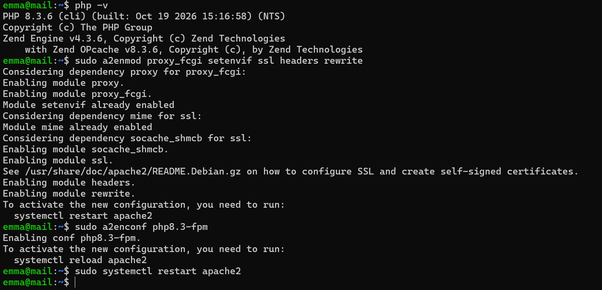
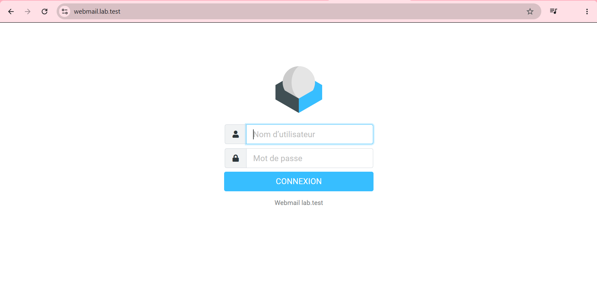
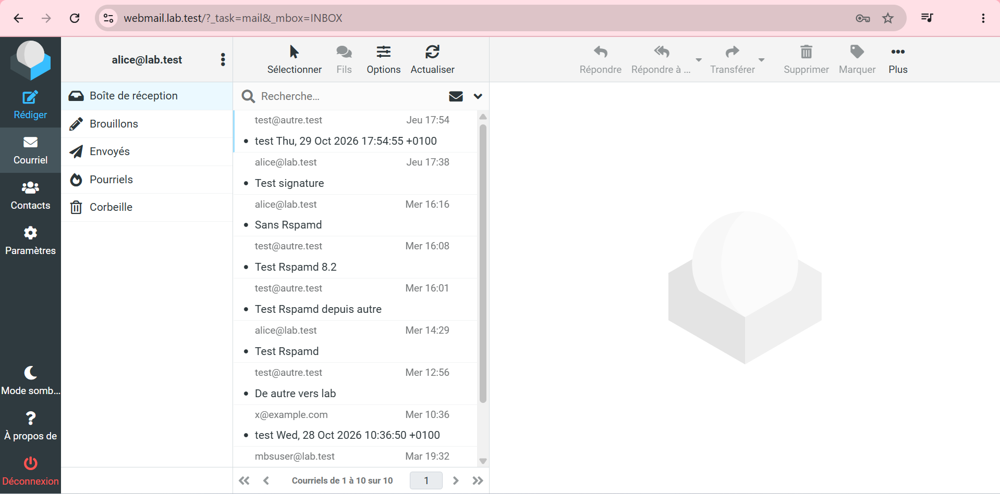
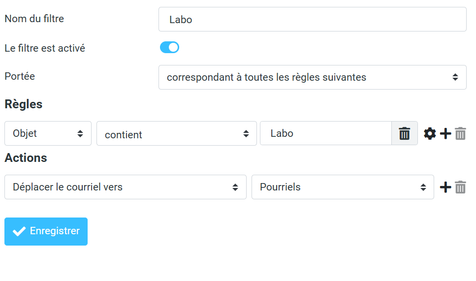
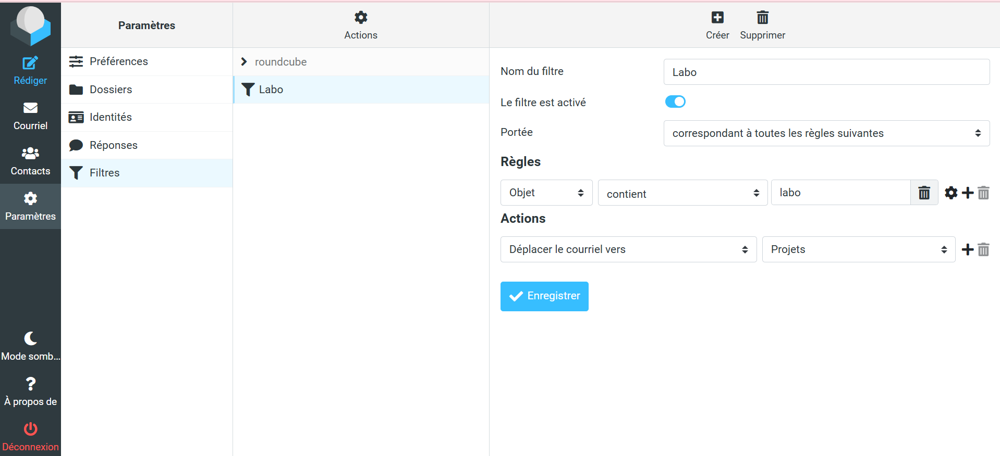
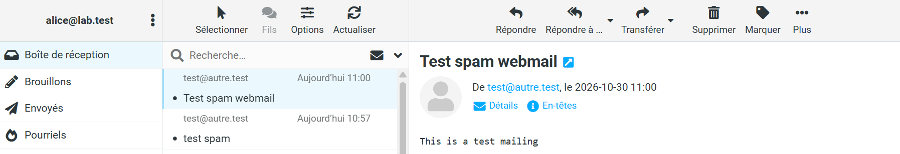
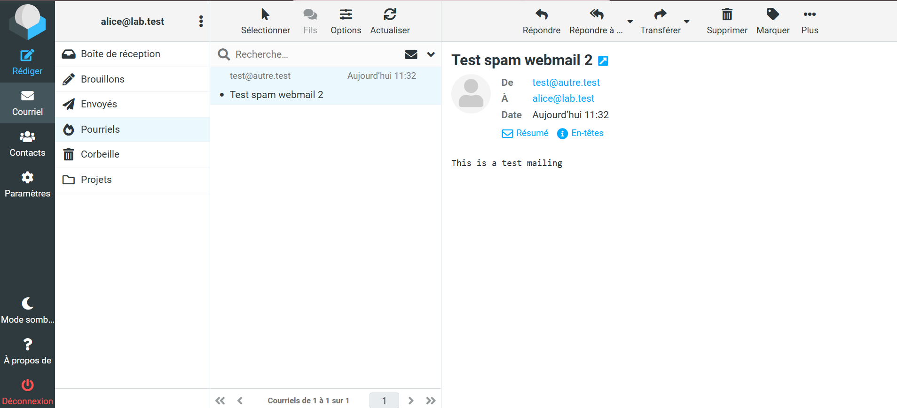

# Preuves — Étape 12 : Webmail Roundcube

Date des tests : 30/10/2026 (compléments le 30/10/2026) · Instantané : `12-webmail`

| # | Contrôle | Commande | Attendu | Obtenu |
| --- | --- | --- | --- | --- |
| 1 | Services | `systemctl is-active apache2 php8.3-fpm dovecot` | active ×3 | ⬜ |
| 2 | PHP hors d'Apache | `sudo apachectl -M \| grep php` | Aucune ligne | ⬜ |
| 3 | Configuration Apache | `sudo apachectl configtest` | Syntax OK | ⬜ |
| 4 | Redirection | `curl.exe -sI http://webmail.lab.test` | 301 vers HTTPS | ⬜ |
| 5 | HTTPS de confiance | `navigateur` | Cadenas, aucun avertissement | ✅ [capture](../docs/img/etape-12-connexion.png) |
| 6 | Utilisation | `lire, envoyer, supprimer, déplacer` | Réussi | ✅ [capture](../docs/img/etape-12-boite-reception.png) — lecture |
| 7 | Filtre personnel | `message [labo]` | Rangé dans Projets | ✅ [capture](../docs/img/etape-12-filtre-projets.png) [capture](../docs/img/etape-12-filtre-resultat.png) |
| 8 | Spam | `seuil temporaire -5` | Rangé dans Pourriels, X-Spam-Status: Yes | ✅ [capture](../docs/img/etape-12-spam-pourriels.png) — X-Spam-Status non relevé |
| 9 | ManageSieve local | `sudo ss -ltnp \| grep 4190` | 127.0.0.1:4190 | ⬜ |
| 10 | Prison webmail | `sudo fail2ban-regex /var/log/roundcube/errors.log roundcube-auth` | Failregex > 0 | ⬜ |

✅ vérifié, avec capture · ➖ écart expliqué · ⬜ pas de capture conservée.

## Captures

*PHP 8.3 et modules Apache*

*Page de connexion en HTTPS, sans avertissement*

*Boîte de réception d'alice*

*Premier filtre dirigé vers Pourriels (corrigé)*

*Filtre Labo vers Projets*

![Message [labo] rangé dans Projets](../docs/img/etape-12-filtre-resultat.png)
*Message [labo] rangé dans Projets*

*Problème : spam resté en boîte de réception*

*Après correction : spam dans Pourriels*
